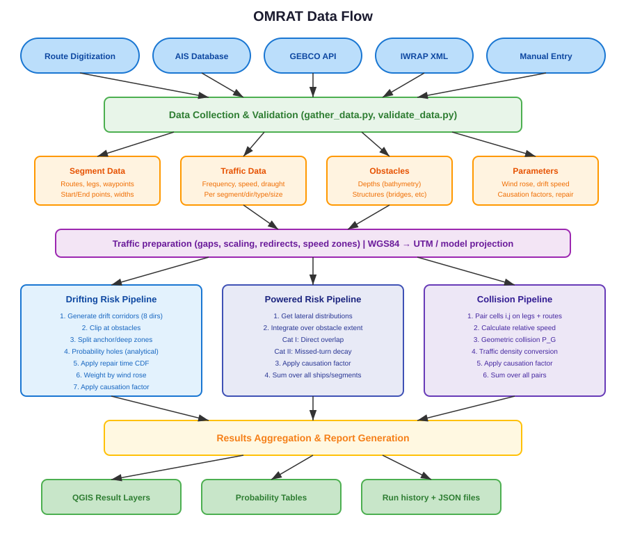

.. _architecture:

=================
Code Architecture
=================

This chapter describes the internal architecture of OMRAT, including
the module structure, class hierarchy, and data flow between components.

.. contents:: In this chapter
   :local:
   :depth: 2

Directory Structure
===================

::

   OMRAT/
   ├── omrat.py                    # Main plugin class (entry point, slim facade)
   ├── omrat_widget.py             # Main window (parentless dock widget)
   ├── omrat_base.ui               # Qt Designer file of the main window
   ├── __init__.py                 # Plugin initialisation (classFactory)
   │
   ├── compute/                    # Risk calculation engine
   │   ├── basic_equations.py      # Core mathematical formulas
   │   ├── run_calculations.py     # Calculation facade (mixins, begin_run)
   │   ├── calculation_task.py     # QgsTask wrapper for background exec
   │   ├── run_phases.py           # Model parts of a run (Calculation matrix)
   │   ├── traffic_pipeline.py     # Gap fill -> scaling -> redirects -> speed zones
   │   ├── traffic_gaps.py         # Fill missing speeds / draughts
   │   ├── traffic_scaling.py      # Scaling (%) matrices
   │   ├── traffic_redirect.py     # Suppressed legs: move their traffic
   │   ├── speed_restriction.py    # Speed restriction zones
   │   ├── data_preparation.py     # Lateral distributions, traffic lists, UTM
   │   ├── drifting_model.py       # Drifting cascade (mixin onto Calculation)
   │   ├── drift_corridor_geometry.py  # Drift corridor geometry
   │   ├── drift_reach.py          # Repair-time quantiles, drift reach
   │   ├── drift_start.py          # Start drifting from (leg / distribution)
   │   ├── drifting_report.py      # Drifting report mixin
   │   ├── drifting_report_builder.py  # Drifting report builder mixin
   │   ├── ship_collision_model.py # Ship-ship collisions (mixin)
   │   ├── encounter_angle.py      # Smallest route angle at a waypoint
   │   ├── collision_breakdown.py  # Collision View rows
   │   ├── powered_model.py        # Powered grounding / allision (mixin)
   │   ├── ray_sampling.py         # Powered rays over the lateral mixture
   │   ├── cat1_start_zone.py      # Category I start zone
   │   ├── powered_breakdown.py    # Powered View rows + sidecar
   │   ├── squat.py                # Squat in the grounding models
   │   ├── passenger_reduction.py  # Passenger ship / fast ferry reduction
   │   ├── consequence.py          # Oil-spill catastrophe exceedance
   │   ├── sensitivity.py          # One-at-a-time sensitivity analysis
   │   ├── leg_labels.py           # Leg names in outputs
   │   ├── junction_transitions.py # AIS crossings -> transition counts
   │   ├── visualization.py        # View dialogs (mixin)
   │   ├── iwrap_defaults.py       # IWRAP default values (pc, drift)
   │   ├── database.py             # PostgreSQL/PostGIS connector
   │   └── iwrap_convertion.py     # IWRAP XML import/export
   │
   ├── geometries/                 # Spatial geometry operations
   │   ├── handle_qgis_iface.py    # Route digitisation & layer mgmt
   │   ├── route.py                # Route processing utilities
   │   ├── waypoints.py            # Shared leg end nodes
   │   ├── junctions.py            # Junction registry + transition matrices
   │   ├── route_validation.py     # Close waypoints, X-crossings, split
   │   ├── tangent_position.py     # Movable tangent line
   │   ├── distribution_curves.py  # Lateral mixture + curves on the tangent line
   │   ├── depth_simplify.py       # Depth simplification rule
   │   ├── model_projection.py     # SimpleProjector / ModelProjector
   │   ├── boundary_edges.py       # Canonical obstacle edge numbering
   │   ├── get_powered_overlap.py  # Powered ray caster + View visualiser
   │   ├── drift_corridor_task_v2.py  # Background corridor generation
   │   ├── get_drifting_overlap.py # Overlap dialog facade + visualizer class
   │   ├── drift_overlap_geometry.py  # Pure geometry/distance helpers
   │   ├── drift_overlap_plot.py   # Bottom PDF panel matplotlib helper
   │   ├── drift_overlap_sidebar.py   # Sortable QTableWidget sidebar builder
   │   ├── analytical_probability.py  # Probability holes (used by the model)
   │   ├── calculate_probability_holes.py  # Monte Carlo cross-check
   │   ├── result_layers.py        # Result QGIS layer creation
   │   └── drift/                  # Refactored drift submodule
   │       ├── constants.py        # Direction constants (N,NE,E,...)
   │       ├── coordinates.py      # CRS transformations
   │       ├── distribution.py     # Width & projection distance
   │       ├── corridor.py         # Base surface & projected corridor
   │       ├── shadow.py           # Obstacle blocking zones
   │       ├── clipping.py         # Corridor clipping & anchor split
   │       └── generator.py        # Main corridor generator
   │
   ├── drifting/
   │   └── engine.py               # Compass <-> math angle helpers
   │
   ├── omrat_utils/                # Data management + UI mixins
   │   ├── handle_traffic.py       # Traffic table management
   │   ├── handle_object.py        # Depth & structure management
   │   ├── handle_ais.py           # AIS database integration
   │   ├── ais_update_task.py      # Background AIS update
   │   ├── ais_binning.py          # AIS length binning rules
   │   ├── ship_type_map.py        # IMO / MMSI ship type mapping
   │   ├── handle_distributions.py # Lateral distribution modelling
   │   ├── handle_settings.py      # Drift parameter configuration
   │   ├── handle_ship_cat.py      # Ship type classifications
   │   ├── handle_junctions.py     # Live junction registry
   │   ├── handle_consequence.py   # Oil-spill consequence inputs
   │   ├── speed_restriction_zones.py  # Speed zones: state + map layer
   │   ├── causation_factors.py    # Causation factor management
   │   ├── gather_data.py          # Data serialisation/deserialisation
   │   ├── storage.py              # Project file I/O (.omrat JSON)
   │   ├── validate_data.py        # Pydantic validation schemas
   │   ├── project_sanitize.py     # Save / load / run fixes
   │   ├── layer_styles.py         # Layer styles in the project file
   │   ├── repair_time.py          # Repair time distribution
   │   ├── copy_traffic.py         # Copy traffic + AIS lock (pure)
   │   ├── traffic_links.py        # Links between legs (pure)
   │   ├── traffic_summary.py      # Traffic report content (pure)
   │   ├── traffic_report_html.py  # Traffic report HTML page (pure)
   │   ├── traffic_report_dialog.py   # Traffic report save + open
   │   ├── table_clipboard.py      # Traffic table copy / paste (pure)
   │   ├── route_validation_ui.py  # Validation pass + crossing checks
   │   ├── *_dialog.py             # Copy traffic, Suppress leg, Waypoint editor,
   │   │                           # Speed restriction zones, Depth simplify,
   │   │                           # Junction matrix, Calculation matrix,
   │   │                           # Sensitivity, Ship type mapping, Previous runs
   │   ├── iwrap_io_mixin.py       # OMRAT IWRAP import/export slots
   │   ├── compare_mixin.py        # Compare-Models tab logic
   │   ├── compare.py              # Compare: totals, settings, leg lengths, run sidecars
   │   ├── compare_inputs.py       # Compare: leg / traffic / junction / depth input diff
   │   ├── compare_breakdown.py    # Compare: per leg / waypoint / object result diff
   │   ├── compare_zone.py         # Compare: common zone around the structures
   │   ├── compare_explain.py      # Compare > More info: why collisions changed (Shapley)
   │   ├── compare_explain_dialog.py  # More info dialog + background task
   │   ├── result_diff.py          # Difference layers (B - A)
   │   ├── drift_analysis_mixin.py # Drift-corridor analysis runner + layers
   │   ├── run_history.py          # Run history (SQLite)
   │   ├── run_persistence.py      # Per-run GeoPackage
   │   ├── run_history_mixin.py    # Auto-save flow + Previous-runs table
   │   ├── result_compare.py       # Result-table run columns (pure)
   │   ├── accident_results_mixin.py  # TWAccidentResults + per-row View dispatcher
   │   ├── sensitivity_mixin.py    # Sensitivity analysis slot
   │   ├── sensitivity_task.py     # Sensitivity runs in the background
   │   ├── full_report.py          # Markdown run report
   │   └── audit_report.py         # Inputs / audit section of the report
   │
   ├── ui/                         # User interface widgets
   │   ├── drift_settings_widget.py
   │   ├── traffic_data_widget.py
   │   ├── ship_categories_widget.py
   │   ├── ais_connection_widget.py
   │   ├── causation_factor_widget.py
   │   ├── ship_type_map_widget.py
   │   ├── oil_onboard_widget.py   # + spill_probability, spill_fraction,
   │   │                           #   catastrophe_levels widgets
   │   ├── result_widget.py
   │   └── show_geom_res.py
   │
   ├── helpers/                    # Helper utilities
   │   └── qt_conversions.py       # Qt5/Qt6 compatibility
   │
   ├── tools/                      # Release checks (run_all_checks.py, ...)
   ├── tests/                      # Test suite
   └── help/                       # Documentation (Sphinx)

Data Flow
=========

The following diagram shows how data flows through OMRAT from input to
output:

The data flow can be summarised in five phases:

1. **Input**: Routes are digitised on the map, traffic data is entered
   or imported from AIS, obstacles are loaded from shapefiles or GEBCO.

2. **Collection**: ``gather_data.py`` aggregates all data into a
   single dictionary for calculation and persistence.

3. **Transformation**: The run's copy of the traffic is prepared
   (``compute/traffic_pipeline.py``: gap fill, scaling, suppressed-leg
   redirects, speed restriction zones) and geometries are projected to
   metres (UTM for drifting, a local transverse Mercator --
   ``ModelProjector`` -- for the powered models).

4. **Calculation**: The selected model parts run one after the other
   in a background task: drifting, ship-ship collisions, powered
   grounding, powered allision, then the oil-spill consequence step.

5. **Output**: Each finished run is saved to the run history (a
   per-run GeoPackage, an input snapshot, a Markdown report and JSON
   sidecars) and shown in the Run Analysis tables; the result layers can
   be added to the map.  The project file holds inputs only.

Key Classes
===========

OMRAT (omrat.py)
-----------------

The main plugin class. It owns the manager components and orchestrates
the plugin lifecycle, but most slot-handling logic now lives in
focused mixins under ``omrat_utils/``.  The class declaration is::

   class OMRAT(
       IwrapIOMixin, CompareMixin, DriftAnalysisMixin, RunHistoryMixin,
       AccidentResultsMixin, SensitivityMixin, CalculationMatrixMixin,
   ):
       ...

What ``omrat.py`` itself still owns:

- **Initialisation**: Creates instances of all manager classes (Traffic,
  OObject, DriftSettings, etc.)
- **Signal management**: Connects UI buttons to handler methods
- **Calculation dispatch**: Creates ``CalculationTask`` or
  ``DriftCorridorTask`` instances for background execution
- **Menu/toolbar**: Registers QGIS menu items and toolbar buttons

What the mixins own:

- ``IwrapIOMixin`` -- IWRAP XML import / export menu actions
- ``CompareMixin`` -- the *Compare Models* tab (snapshot pickers,
  diff tables, layer overlays)
- ``DriftAnalysisMixin`` -- *Run Drift Analysis* slot, per-leg
  categorised polygon layers
- ``RunHistoryMixin`` -- auto-save flow (``.omrat`` snapshot,
  ``.gpkg``, ``.collision.json``, ``.drifting.json``,
  ``.consequence.json`` and ``.powered.json`` sidecars,
  ``_results_<timestamp>.md``) plus the *Previous runs* table
- ``AccidentResultsMixin`` -- the ``TWAccidentResults`` table with
  per-row **View** buttons that dispatch to the interactive
  visualiser of the selected previous run
- ``SensitivityMixin`` -- the **Sensitivity analysis...** button and
  dialog (Run Analysis tab)
- ``CalculationMatrixMixin`` -- the **Calculation matrix...** button,
  the session's ``run_phases`` selection and the *Run model (n of 4
  parts)* label

.. container:: source-code-ref

   ``omrat.py`` -- `OMRAT <https://github.com/axelande/OMRAT/blob/main/omrat.py>`__ (main plugin entry point) |
   `IwrapIOMixin <https://github.com/axelande/OMRAT/blob/main/omrat_utils/iwrap_io_mixin.py>`__,
   `CompareMixin <https://github.com/axelande/OMRAT/blob/main/omrat_utils/compare_mixin.py>`__,
   `DriftAnalysisMixin <https://github.com/axelande/OMRAT/blob/main/omrat_utils/drift_analysis_mixin.py>`__,
   `RunHistoryMixin <https://github.com/axelande/OMRAT/blob/main/omrat_utils/run_history_mixin.py>`__,
   `AccidentResultsMixin <https://github.com/axelande/OMRAT/blob/main/omrat_utils/accident_results_mixin.py>`__,
   `SensitivityMixin <https://github.com/axelande/OMRAT/blob/main/omrat_utils/sensitivity_mixin.py>`__,
   `CalculationMatrixMixin <https://github.com/axelande/OMRAT/blob/main/omrat_utils/calculation_matrix_dialog.py>`__

OMRATMainWidget (omrat_widget.py)
-----------------------------------

The Qt dock widget that provides the user interface.  It is shown as a
parentless top-level window (never docked into QGIS), with the File /
Settings menu bar on top and the tabs in a scroll area below.  It is
built from ``omrat_base.ui`` (Qt Designer file) and contains:

- **Routes tab**: Route table, digitisation buttons, and the
  lateral-distribution panel
- **Traffic Data tab**: Ship frequency/speed/dimension/scaling
  tables
- **Depths tab**: Depth polygon management, GEBCO download
- **Objects tab**: Structure polygon management
- **Run Analysis tab**: Run gating, previous-run history,
  accident-probability and catastrophe-exceedance tables
- **Drift Analysis tab**: Drift-corridor generation and visualisation
- **Compare tab**: Side-by-side diff of two runs (Totals, Settings &
  inputs, Breakdown, Zone, Leg lengths)

Calculation (compute/run_calculations.py)
------------------------------------------

The main calculation engine. Key responsibilities:

- ``begin_run(data, phases)``: Resets every phase's results to "not
  calculated" before a run (partial runs, :ref:`Calculation matrix <calculation-matrix>`)
- ``run_drifting_model(data)``: Computes drifting grounding/allision
  probabilities using analytical probability-hole integration
- ``run_ship_collision_model(data)``: Computes ship-ship collision
  frequencies (head-on, overtaking, crossing, merging, bend)
- ``run_powered_grounding_model(data)``: Computes powered grounding
  (Category I and II) with depth-bin caching and per-bin progress
  updates
- ``run_powered_allision_model(data)``: Computes powered allision
  (Category I and II)
- ``run_drift_visualization(data)``: Creates visual corridor layers

.. container:: source-code-ref

   ``compute/run_calculations.py:45`` -- `Calculation <https://github.com/axelande/OMRAT/blob/main/compute/run_calculations.py#L45>`__ (mixin-based facade) |
   Mixins: `DriftingModelMixin <https://github.com/axelande/OMRAT/blob/main/compute/drifting_model.py>`__,
   `ShipCollisionModelMixin <https://github.com/axelande/OMRAT/blob/main/compute/ship_collision_model.py>`__,
   `PoweredModelMixin <https://github.com/axelande/OMRAT/blob/main/compute/powered_model.py>`__,
   `DriftingReportMixin <https://github.com/axelande/OMRAT/blob/main/compute/drifting_report.py>`__,
   `VisualizationMixin <https://github.com/axelande/OMRAT/blob/main/compute/visualization.py>`__

DriftCorridorGenerator (geometries/drift/generator.py)
-------------------------------------------------------

Orchestrates drift corridor generation for all legs and directions:

- ``precollect_data()``: Gathers UI data in the main thread (required
  because Qt widgets are thread-unsafe)
- ``generate_corridors()``: Generates corridors in a background thread
- ``_create_single_corridor()``: Creates one corridor for one leg in
  one direction

.. container:: source-code-ref

   ``geometries/drift/generator.py:107`` -- `DriftCorridorGenerator <https://github.com/axelande/OMRAT/blob/main/geometries/drift/generator.py#L107>`__ |
   ``geometries/drift/generator.py:147`` -- `precollect_data() <https://github.com/axelande/OMRAT/blob/main/geometries/drift/generator.py#L147>`__ |
   ``geometries/drift/generator.py:366`` -- `generate_corridors() <https://github.com/axelande/OMRAT/blob/main/geometries/drift/generator.py#L366>`__ |
   ``geometries/drift/generator.py:461`` -- `_create_single_corridor() <https://github.com/axelande/OMRAT/blob/main/geometries/drift/generator.py#L461>`__

HandleQGISIface (geometries/handle_qgis_iface.py)
---------------------------------------------------

Manages QGIS layer operations for route digitisation:

- Route creation via map click tool
- Segment data tracking (start/end points, directions, widths)
- Visual offset lines showing route width
- Geometry change detection for interactive editing
- Geometry edit persistence: map edits are synchronised back to
  ``segment_data`` (start/end points, directions, and line length), so
  save/export use the edited geometry
- Shared waypoints: legs hang on nodes (``omrat.waypoints``), so
  dragging a node moves every leg on it and clicks snap to existing
  nodes
- Tangent line layer: the movable tangent / AIS passage line, the
  lateral distribution curves and the ray-span marks
- Crossing checks: a vertex drag that makes legs cross without a shared
  waypoint offers to split them

.. container:: source-code-ref

   ``geometries/handle_qgis_iface.py`` -- `HandleQGISIface <https://github.com/axelande/OMRAT/blob/main/geometries/handle_qgis_iface.py>`__

Data Structures
===============

Traffic Data
------------

Traffic data is stored in a nested dictionary::

   traffic_data[segment_id][direction] = {
       'Frequency (ships/year)': [[float, ...], ...], # [type][size]
       'Speed (knots)':          [[float, ...], ...],
       'Draught (meters)':       [[float, ...], ...],
       'Ship heights (meters)':  [[float, ...], ...],
       'Ship Beam (meters)':     [[float, ...], ...],
       'Scaling (%)':            [[float, ...], ...],  # per-cell frequency multiplier (default 100)
   }

Each value is a 2D array indexed by ``[ship_type_index][ship_size_index]``.

The first block of a leg is always ``Dirs[0]``, the drawn direction;
compute reads the blocks by position.

Before any model runs, ``CalculationTask.run`` prepares its copy of the
data with ``compute.traffic_pipeline.prepare_traffic_for_run``, in this
order:

1. ``compute.traffic_gaps.fill_traffic_gaps`` -- cells with ships but
   no speed / draught are filled (:ref:`traffic-gaps`).
2. ``compute.traffic_scaling.apply_traffic_scaling`` -- multiplies every
   ``Frequency (ships/year)`` cell by ``Scaling / 100``.  Every
   downstream model reads the post-scaling Frequency, so the per-row
   "follow global" / global-spinbox UI on the Traffic Data tab is
   inherited by ship-ship, powered, drifting and consequence without
   any per-model code change.
3. ``compute.traffic_redirect.apply_traffic_redirects`` -- resolves
   suppressed legs (``segment_data[seg]['suppressed']``, see
   :ref:`suppress-leg`).  It adds their traffic to the target legs
   listed in ``traffic_redirect`` and then removes the suppressed legs
   from ``segment_data``, ``traffic_data`` and the junction matrices.
   The models therefore never see a suppressed leg and need no code of
   their own for it.
4. ``compute.speed_restriction.apply_speed_restrictions`` -- caps the
   speeds in the speed restriction zones (:ref:`speed-restriction-zones`).

The sensitivity runner (``omrat_utils/sensitivity_task.run_phases_on_stub``)
and the collision explanation of the Compare tab
(``compare_explain.run_collision_model``) call the same function.  The
IWRAP export resolves the suppressed legs
(``compute.traffic_redirect.prepare_export_data``) and fills the gaps,
but ignores the speed restriction zones.

Segment Data
------------

::

   segment_data[segment_id] = {
       'Start_Point': str,      # "lon lat", six decimals
       'End_Point': str,        # "lon lat", six decimals
       'start_wp': str,         # Waypoint (node) ids
       'end_wp': str,
       'Dirs': [str, str],      # Direction labels; Dirs[0] = drawn direction
       'Width': int,            # Tangent / AIS passage line length (m)
       'Tangent_Pos': float,    # Tangent position along the leg (0..1)
       'line_length': float,    # Segment length (m)
       'Route_Id': int,
       'Leg_name': str,         # LEG_<route>_<n>
       'Segment_Id': str,       # Global leg id (never reused)
       'ai1': float, 'ai2': float,  # Position check interval (s)
       # Distribution parameters:
       'mean1_1': float, 'std1_1': float, 'weight1_1': float,
       'mean1_2': float, 'std1_2': float, 'weight1_2': float,
       'mean1_3': float, 'std1_3': float, 'weight1_3': float,
       'u_min1': float, 'u_max1': float, 'u_p1': float,
       # ... same for direction 2 ...
       # Optional: traffic_locked, traffic_source, suppressed,
       # traffic_redirect, suppressed_with
   }

See :ref:`reference-data-format` for every key.

Drift Values
------------

::

   drift_values = {
       'drift_p': float,           # Blackout rate (events per ship-year)
       'blackout_by_ship_type': {int: float},  # Per-type blackout rates
       'anchor_p': float,          # Anchor probability
       'anchor_d': float,          # Anchor depth factor (x draught)
       'speed': float,             # Drift speed (knots)
       'start_from': str,          # 'leg_center' | 'distribution_center'
       'rose': {                   # Wind rose probabilities (drift direction)
           '0': float,             # North
           '45': float,            # NorthEast
           '90': float,            # East
           '135': float,           # SouthEast
           '180': float,           # South
           '225': float,           # SouthWest
           '270': float,           # West
           '315': float,           # NorthWest
       },
       'repair': {
           'func': str,            # Custom function expression
           'std': float,           # Lognormal shape
           'loc': float,           # Location parameter
           'scale': float,         # Scale parameter
           'use_lognormal': bool,  # Use lognormal or custom
       }
   }

Background Task Execution
==========================

OMRAT uses QGIS's ``QgsTask`` system for long-running calculations.
This keeps the UI responsive while computations run in background
threads.

CalculationTask
----------------

Wraps the full risk calculation pipeline.  It first runs
``prepare_traffic_for_run()`` on the run's copy of the data and
``Calculation.begin_run()``, then:

1. ``run_drifting_model()`` -- probability holes (60% of time)
2. ``run_ship_collision_model()`` -- collision frequencies (fast)
3. ``run_powered_grounding_model()`` -- powered grounding
4. ``run_powered_allision_model()`` -- powered allision
5. ``compute_catastrophe_exceedance()`` -- oil-spill consequence, on
   whichever reports the run produced

Only the parts selected in the **Calculation matrix** run (``phases``,
``compute/run_phases.py``); the order is always the one above.

Signals emitted: ``progress_updated``, ``calculation_finished``,
``calculation_failed``.

.. container:: source-code-ref

   ``compute/calculation_task.py`` -- `CalculationTask <https://github.com/axelande/OMRAT/blob/main/compute/calculation_task.py>`__

DriftCorridorTask
------------------

Wraps the drift corridor generation:

1. ``precollect_data()`` runs in the main thread (before task starts)
2. ``generate_corridors()`` runs in the background thread
3. Layer creation runs in the main thread (via ``finished()`` signal)

Signals emitted: ``progress_updated``, ``corridors_generated``,
``generation_failed``.

.. container:: source-code-ref

   ``geometries/drift_corridor_task_v2.py`` -- `DriftCorridorTask <https://github.com/axelande/OMRAT/blob/main/geometries/drift_corridor_task_v2.py>`__

IWRAP Integration
=================

OMRAT supports bidirectional conversion with IWRAP XML format:

**Export** (``IwrapIOMixin.export_to_iwrap`` -> ``write_iwrap_xml`` ->
``generate_iwrap_xml``):

1. Gather project data via ``GatherData``
2. Resolve suppressed legs on a copy
   (``compute.traffic_redirect.prepare_export_data``).  If there are
   any, a warning lists the moves and the user can cancel.
3. Fill traffic gaps on the copy as a run does (missing speeds /
   draughts, beam from the length class)
4. Build XML tree with waypoints, legs, traffic distributions (OMRAT's
   ship types and length classes merged onto IWRAP's, ship-weighted),
   the junction matrices as ``MANUAL`` leg-to-leg rows, causation
   factors and obstacles
5. Write formatted XML file; the confirmation lists any merged length
   classes

**Import** (``IwrapIOMixin.import_from_iwrap`` -> ``parse_iwrap_xml``):

1. Parse XML tree structure
2. Extract waypoints, legs, traffic, junction rows (read back as
   ``user`` matrices), drifting settings, causation factors, areas
3. Map to OMRAT's internal data format
4. Normalise (``Storage._normalize_legacy_to_schema``) and validate
   with the Pydantic schema (a failure warns but still loads)
5. Populate UI via ``GatherData.populate()``

The conversion handles differences in data model between IWRAP and OMRAT,
including coordinate format, traffic representation, and distribution
parameters.  The modelling differences that remain are listed in
:ref:`iwrap-differences`.

.. container:: source-code-ref

   ``compute/iwrap_convertion.py`` -- `IWRAP conversion module <https://github.com/axelande/OMRAT/blob/main/compute/iwrap_convertion.py>`__

Project Persistence
===================

Projects are saved as ``.omrat`` files (JSON format):

::

   {
     "omrat_version": "0.18.1",
     "project_name": "My Analysis",
     "pc": {"p_pc": 1.6e-4, "d_pc": 1, "headon": 4.9e-5, ...},
     "drift": {
       "drift_p": 1, "anchor_p": 0.7, "anchor_d": 7,
       "speed": 1.0, "start_from": "leg_center",
       "rose": {...}, "repair": {...}
     },
     "traffic_data": {...},
     "segment_data": {...},
     "waypoints": {...},
     "depths": [[id, depth, wkt], ...],
     "objects": [[id, height, wkt], ...],
     "ship_categories": {...},
     "junctions": {...},
     "consequence": {...},
     "traffic_scaling": {...},
     "layer_styles": {...},
     "segments_imported": {...},
     "speed_restriction_zones": [...]
   }

Every key is described in :ref:`reference-data-format`.  The
``validate_data.py`` module defines a Pydantic schema
(``RootModelSchema``) that validates the structure on save and load.
``omrat_utils/project_sanitize.py`` makes the data pass it on both
sides (empty observation cells, missing distribution fields, orphan
traffic blocks), and legacy format conversion is handled by
``Storage._normalize_legacy_to_schema()``.  Results are not saved in
the project file; each run writes its own files (see the run-history
part of :ref:`reference-data-format` and :ref:`previous-runs-table`).

.. container:: source-code-ref

   ``omrat_utils/storage.py`` -- `Storage <https://github.com/axelande/OMRAT/blob/main/omrat_utils/storage.py>`__ |
   ``omrat_utils/validate_data.py`` -- `Validation schemas <https://github.com/axelande/OMRAT/blob/main/omrat_utils/validate_data.py>`__
