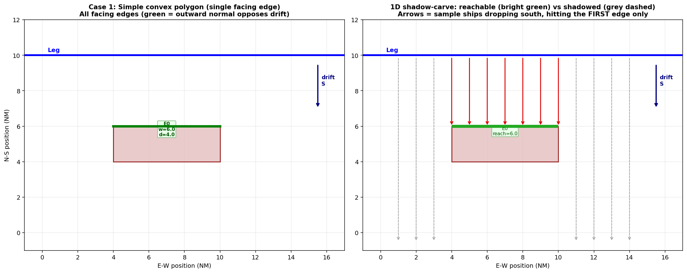
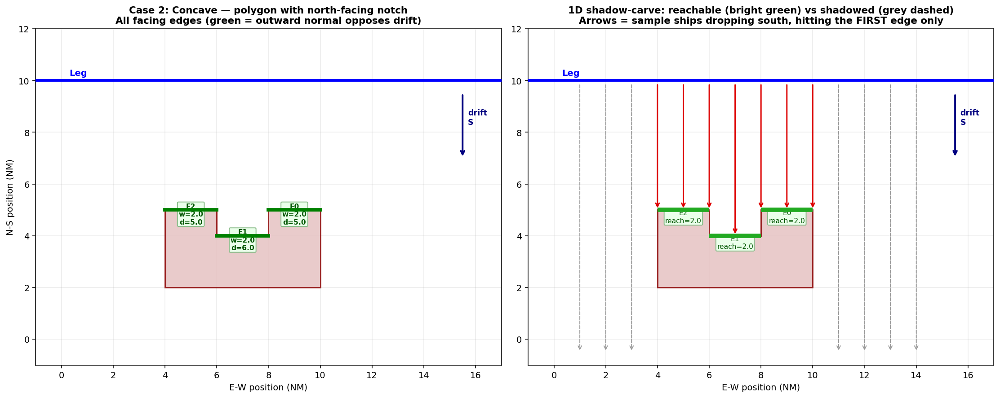
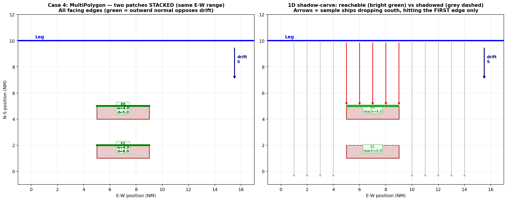
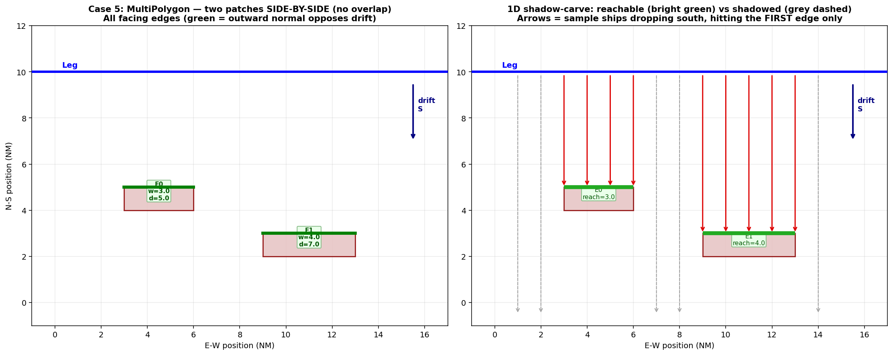
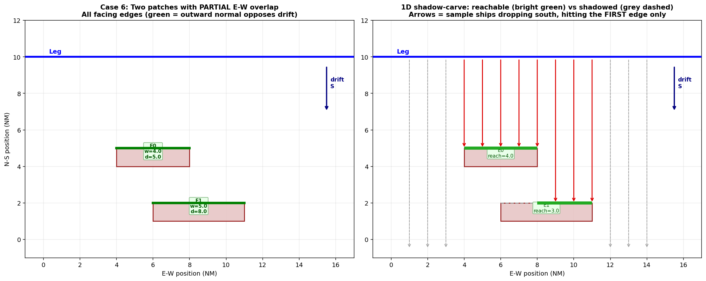

.. _code-flow-drifting:

==========================================
Code Flow: Drifting Model
==========================================

This chapter walks the drifting model one function at a time, in the
order that the calls fire when a user presses **Run model**.  Pair it
with the theory chapter :ref:`drifting`, which derives the formulas
that each function below implements.

.. contents:: In this chapter
   :local:
   :depth: 2

Entry point
===========

:meth:`DriftingModelMixin.run_drifting_model` is phase 1 of
:class:`~compute.calculation_task.CalculationTask` (see
:ref:`code-flow`), run when **Drifting** is ticked in the Calculation
matrix.  Before any phase, ``CalculationTask._prepare_traffic`` runs
:func:`compute.traffic_pipeline.prepare_traffic_for_run` on the run's
copy of the data: missing speeds / draughts are filled
(``compute/traffic_gaps.py``), ``Scaling (%)`` is applied, suppressed
legs' traffic is moved, and speed restriction zones replace
``Speed (knots)`` by the time-equivalent speed along the leg.  The drift
model therefore sees the filled, scaled and restricted traffic (a slower
speed means more hours on the leg).

It takes a single ``data`` dict and writes

* ``self.drifting_allision_prob``
* ``self.drifting_grounding_prob``
* ``self.drifting_report``
* ``self.allision_result_layer``, ``self.grounding_result_layer``
* ``LEPDriftAllision.setText(...)`` / ``LEPDriftingGrounding.setText(...)``

Without traffic or legs, without obstacles, or when the user cancels
during the shadow / bucket phases, it returns through
``_emit_zero_drifting`` (a zero report, not ``None``).

.. container:: source-code-ref pipeline

   **Entry:** ``compute/drifting_model.py:2222`` -- `run_drifting_model() <https://github.com/axelande/OMRAT/blob/main/compute/drifting_model.py#L2222>`__

Top-level call tree
===================

::

   run_drifting_model(data)
     |
     +-- _build_transformed(data)                                         # UTM projection + geom prep
     |     +-- prepare_traffic_lists(data)                                # compute/data_preparation.py
     |     |     +-- clean_traffic(data)                                  # one line per leg x direction
     |     +-- split_structures_and_depths(data)
     |     +-- transform_to_utm(lines, structure+depth wkts)
     |     +-- shapely.make_valid  (per obstacle)
     |
     +-- _compute_reach_distance(data, longest_length)                    # compute/drift_reach.py, 99 % repaired
     |
     +-- _merge_depths_by_threshold(data, depths, drift)                  # shapely.unary_union per level
     |
     +-- _precompute_spatial(..., data)                                   # = "spatial" progress phase
     |     +-- compute_min_distance_by_object(..., distance_lines)        # geometries/drift_overlap_geometry.py
     |     +-- compute_probability_holes_analytical(...)                  # geometries/analytical_probability.py
     |           +-- ThreadPoolExecutor (per leg x direction)
     |                 +-- _compute_single_direction_analytical(...)
     |                       +-- compute_probability_analytical(...)
     |                             +-- _vectorized_edge_y_intervals(...)
     |                             +-- _merge_intervals_across_slices(...)
     |                             +-- dist.cdf(array)                    # batched scipy CDF
     |
     +-- _precompute_shadow_layer(...)                                    # = "shadow" progress phase (0..50%)
     |     +-- _compute_global_shadow_bounds(...)
     |     +-- _precompute_leg_lateral_params(..., use_offset)
     |     +-- _run_shadow_pool  -> ThreadPoolExecutor (per leg x direction)
     |           +-- _shadow_task(leg_idx, d_idx) -> _build_shadow_entry(...)
     |                 +-- _compute_drift_corridor_and_bounds(...)
     |                 |     +-- _create_drift_corridor(...)
     |                 +-- _ahead_of_leg(line, angle, corridor)          # corridor on the drift side of the leg
     |                 +-- _corridor_shadow(poly, ahead, ...)            # obstacle clipped to it first
     |                 |     +-- _build_blocker_shadow(..., shadow_memo)
     |                 |           +-- extract_polygons(geom)
     |                 |           +-- create_obstacle_shadow(p, compass, bounds)  # memo only when unclipped
     |                 +-- _build_edge_geom_for_poly(poly, ...)
     |                       +-- _extract_obstacle_segments(poly)
     |                       +-- segment_corridor_overlap_length(...)   # facing-edge filter
     |                       +-- compute_edge_reachable_widths_1d(...)  # 1D shadow-carve
     |                       +-- directional_distances_to_points(...)    # vectorised drift distance
     |                       +-- get_not_repaired(...)                   # analytical ndtr / Weibull
     |
     +-- _precompute_bucket_memo(...)                                     # = "shadow" progress phase (50..100%)
     |     +-- _collect_bucket_obs(...)  -> _collect_cell_obstacles(...)
     |     +-- _run_bucket_parallel  -> ThreadPoolExecutor (per (leg, dir, ship-bucket))
     |           +-- _compute_bucket_entries(...)
     |                 +-- geom.difference(blocker_union)
     |                 +-- _analytical_hole_for_geom(reach, ...)
     |                       +-- extract_polygons + _extract_polygon_rings
     |                       +-- compute_probability_analytical(...)
     |                 +-- shapely.unary_union
     |
     +-- _iterate_traffic_and_sum(...)                                    # = "cascade" progress phase (60..90%)
     |     +-- clean_traffic(data)
     |     +-- for each leg: _process_leg_cells(...)
     |           for each ship cell, direction:
     |           _process_cell_direction(...)
     |             +-- _collect_cell_obstacles(...) + _lookup_bucket_entries(...)
     |             +-- _recarve_edges_inter_obstacle(...)
     |             +-- _apply_hit_entry(...) / _apply_anchoring_entry(...)
     |                   +-- _update_report(...) / _update_anchoring_report(...)
     |                   +-- _add_direct_segment_contrib(...), _record_edge_meta(...)
     |
     +-- _apply_drifting_risk_factors(...)
     +-- _store_depth_meta(...)
     +-- _finalize_drifting(...)                                          # = "layers" phase
           +-- _auto_generate_drifting_report(data)                       # writes Markdown
           +-- create_result_layers(report, ...)

The sections below open each box above, in the order the code executes.

:meth:`_build_transformed`: lat/lon -> UTM
==========================================

:meth:`DriftingModelMixin._build_transformed` is a one-time geometry
prep step that runs entirely on the calculation thread.  It returns
nine parallel lists used by every downstream helper.

.. container:: source-code-ref pipeline

   **Source:** ``compute/drifting_model.py:1174`` -- `_build_transformed() <https://github.com/axelande/OMRAT/blob/main/compute/drifting_model.py#L1174>`__

Calls performed:

1. :func:`compute.data_preparation.prepare_traffic_lists(data)` - returns
   ``(lines, distributions, weights, line_names)``.

   * ``lines`` is a list of :class:`shapely.geometry.LineString` in
     EPSG:4326, one per leg **and traffic direction**
     (:func:`clean_traffic`): direction 1 is drawn ``Start_Point ->
     End_Point``, direction 2 as the reversed line.  Every later
     ``leg_idx`` indexes this list.
   * ``distributions`` is ``list[list[scipy.stats.rv_frozen]]`` -- one
     list per line with three normals parsed from
     ``mean{d}_{i}``/``std{d}_{i}``/``weight{d}_{i}`` plus the uniform
     part (``u_min{d}``/``u_max{d}``/``u_p{d}``); unused components are
     placeholders with weight 0.  Direction 2 is read with
     ``get_distribution(..., mirror=True)``: means negated and the
     uniform bounds flipped, so its lane lies on its own side of the leg
     (before 2026-11-10 it was read unmirrored and sailed on the wrong
     side).
   * ``weights`` is the matching list of weights as stored (normalised
     later, where they are used).
   * ``line_names`` are the labels ``"Leg <seg>-<direction>"``; the
     cascade takes the ``Segment_Id`` from them.

2. :func:`compute.data_preparation.split_structures_and_depths(data)` -
   converts the ``depths`` / ``objects`` lists of
   ``[id, value, wkt]`` into two lists of dicts with parsed shapely
   geometries.  MultiPolygons are split into their component polygons
   so every entry has a single :class:`shapely.geometry.Polygon`.

3. :func:`compute.data_preparation.transform_to_utm(lines, obstacle_geoms)` -
   picks the UTM zone of the mean centroid of all legs and obstacles, transforms
   every leg and obstacle once via QGIS
   :class:`~qgis.core.QgsCoordinateTransform` when running inside
   QGIS, or :mod:`pyproj` otherwise.  All subsequent geometry math is
   in metres.

4. :func:`shapely.make_valid` on every obstacle.  If the result is a
   MultiPolygon it is again split into components.  Each final polygon
   is stored with its WGS84 version (``wkt_wgs84``) so that result
   layers generated later use the same vertex order as the UTM
   version.

Output:
``(lines, distributions, weights, line_names, structures,
depths, structs_gdfs, depths_gdfs, transformed_lines)``.

:meth:`_compute_reach_distance`
================================

Computes the "99th percentile drift distance": how far a ship can drift
before the repair distribution says it almost certainly got its engine
back.

.. container:: source-code-ref pipeline

   **Source:** ``compute/drifting_model.py:83`` -- `_compute_reach_distance() <https://github.com/axelande/OMRAT/blob/main/compute/drifting_model.py#L83>`__

Logic (:func:`compute.drift_reach.drift_reach_m` with
``REACH_QUANTILE = 0.99``; the repair-time quantiles live only in
``compute/drift_reach.py``, which the depth simplification tool also
uses):

* :func:`~compute.drift_reach.repair_time_quantile_h` reads
  ``drift.repair``: ``dist_type == 'weibull'`` ->
  ``scipy.stats.weibull_min(...).ppf(0.99)``, ``'normal'`` ->
  ``scipy.stats.norm(...).ppf(0.99)``, else ``use_lognormal`` ->
  ``scipy.stats.lognorm(...).ppf(0.99)``, else a user CDF expression
  (``func``) solved by bisection.
* Multiplies the hours by the drift speed (knots x 1852) to get metres.
* Caps at ``10 x longest_leg_length`` so that a poorly-parameterised
  repair distribution can't make the reach distance degenerate; the cap
  is also the value when no quantile can be computed.

Depth merging (optional)
========================

Before the spatial precompute, :meth:`_merge_depths_by_threshold`
examines the set of depth polygons.  If there are more polygons than
unique depth values plus one, the method merges all polygons with
depth <= boundary into one cumulative polygon per boundary via
:func:`shapely.unary_union`.  The result is:

* ``merged_depths_gdfs`` / ``merged_depths_meta`` - a much smaller set
  of obstacles used by the expensive spatial phase.
* ``threshold_to_idx`` - maps any draught or anchor threshold ``T`` to
  the index of the merged polygon of the highest boundary *below*
  ``T``.  The thresholds are the cells' ``draught`` (which includes the
  squat when **Add squat to the draught in drifting grounding** is
  ticked, ``pc['squat_drifting']``, ``compute/squat.py``) and
  ``anchor_d x anchor_draught`` (the static draught, without squat), all
  rounded to two decimals.  The cascade uses this to look up grounding /
  anchoring obstacles per ship cell in O(1).

Without merging every depth polygon is checked per cell: depth <
draught -> grounding, depth < ``anchor_d`` x static draught ->
anchoring.  Either way the anchoring area of a ship contains its
grounding area.

This is the single biggest source of speedup for projects with dense
bathymetry (tens of depth contours map to just a handful of unique
levels).

Phase 1: :meth:`_precompute_spatial` (``spatial``, 0--40 %)
============================================================

Ship-independent pre-computation of everything that depends on leg
geometry only.

.. container:: source-code-ref pipeline

   **Source:** ``compute/drifting_model.py:1302`` -- `_precompute_spatial() <https://github.com/axelande/OMRAT/blob/main/compute/drifting_model.py#L1302>`__

Returns four lists, each indexed ``[leg_idx][math_dir_idx][obstacle_idx]``:

* ``struct_min_dists`` - nearest along-drift distance from leg to
  each structure (or ``None`` if the obstacle is out of reach in that
  direction).  Computed by
  :func:`geometries.get_drifting_overlap.compute_min_distance_by_object`.
  With **Start drifting from: Distribution center**
  (``drift['start_from'] = 'distribution_center'``,
  ``compute/drift_start.py``) the distance is measured from
  ``distance_lines``: each line offset by the weighted mean of its
  lateral distribution (:func:`~compute.drift_start.mixture_mean`); an
  object behind that line keeps its distance from the leg.  This sets
  the obstacle order and the obstacle-level :math:`P_{NR}` distance.
* ``depth_min_dists`` - same for depth (grounding / anchoring)
  polygons.
* ``struct_probability_holes`` - :math:`h_X` = the share of the lateral
  traffic distribution whose drift path (within the reach distance)
  crosses the obstacle, averaged along the leg.  Computed by
  :func:`geometries.analytical_probability.compute_probability_holes_analytical`.
  This is the only path: the Monte Carlo estimator
  (:func:`geometries.calculate_probability_holes.compute_probability_holes`)
  is kept as a cross-check for tests and examples, and a stale
  ``use_analytical`` key in a project file is ignored.
* ``depth_probability_holes`` - same for depth polygons.

Inside the analytical path
--------------------------

:func:`compute_probability_holes_analytical` parallelises per
``(leg, direction)`` across a :class:`~concurrent.futures.ThreadPoolExecutor`
with ``cpu_count() - 1`` workers.  Each worker calls
:func:`_compute_single_direction_analytical`, which for each object
calls :func:`compute_probability_analytical`:

1. Slice the leg into 100 cross-sections (``s_values`` = midpoints of
   100 equal intervals along the leg; the bucket carve in Phase 3 uses
   200).  The lateral range is :math:`\pm 5\sigma_w`, with
   :math:`\sigma_w` the weight-averaged standard deviation of the
   components; an object farther from the line than the reach distance
   plus that range gets a hole of 0 without integration.
2. For every edge of the obstacle and every slice, solve for the
   ``y``-range of ``perp_offset`` values whose drift ray crosses that
   edge.  This is done in one batched numpy call
   (:func:`_vectorized_edge_y_intervals`) over all slices x all edges.
3. Per slice, merge the valid intervals into disjoint ones
   (:func:`_merge_intervals_across_slices`, batched over all slices).
4. Flatten every merged interval into two 1-D arrays ``los`` and
   ``his`` across every slice.
5. Evaluate the weighted distribution CDF **once** per distribution on
   both arrays (scipy's ``dist.cdf`` is vectorised over array input),
   subtract, and sum.  Divide by ``n_slices`` to get the probability
   hole.

Performance note: this used to call ``dist.cdf`` and
``_merge_intervals_vectorized`` per slice, which dominated
``compute_probability_analytical``.  Batching both turned the work
into a handful of scipy calls per obstacle (see
:ref:`code-flow`'s performance timeline).

Phase 2: :meth:`_precompute_shadow_layer` (``shadow``, 0--50 %)
================================================================

For every ``(leg, direction)`` pair, build:

* the drift corridor polygon,
* the quad-sweep shadow for every reachable obstacle,
* per-edge geometry (each facing edge's reachable width across the
  drift, along-drift distance of each edge, :math:`P_{NR}` at that
  distance).

.. container:: source-code-ref pipeline

   **Source:** ``compute/drifting_model.py:797`` -- `_precompute_shadow_layer() <https://github.com/axelande/OMRAT/blob/main/compute/drifting_model.py#L797>`__

Pre-computation outside the thread pool:

1. Build ``leg_precomputed[leg_idx]``
   (:meth:`_precompute_leg_lateral_params`) with ``dists_dir``, ``w_dir``
   (normalised weights), ``lateral_spread`` = 5 x weighted std of the
   leg's lateral distribution, and a :class:`drifting.engine.LegState`
   whose ``mean_offset_m`` is the mixture mean with **Start drifting
   from: Distribution center** (0 otherwise); the edge distances are
   measured from the line offset by it.
2. Compute a **global shadow bounds**: the bbox of all legs + all
   obstacle geometries, padded by ``max(1 km, reach_distance)``.  This
   is passed to every call to :func:`create_obstacle_shadow`, which
   derives its extrude distance from the corridor bounds.  Using a
   single global bound lets a per-polygon shadow cache hit across
   legs, because the extrude distance (and thus the shadow shape) is
   now the same for every call.

Per-task work (``_shadow_task(leg_idx, d_idx)`` ->
:meth:`_build_shadow_entry`), dispatched by :meth:`_run_shadow_pool`:

1. Build the drift corridor via
   :meth:`_compute_drift_corridor_and_bounds` ->
   :func:`compute.drift_corridor_geometry._create_drift_corridor`: two
   rectangles (leg rect + drifted rect, half-width ``lateral_spread``,
   or 2 500 m when the leg has no lateral distribution, drifted by
   ``reach_distance``) unioned, falling back to convex hull if union
   produces a MultiPolygon.
2. For every structure and every depth (filtered via
   ``struct_min_dists`` / ``depth_min_dists`` to those within
   ``reach_distance``):

   a. Clip the obstacle to the corridor **ahead of the leg**
      (:meth:`_ahead_of_leg`: the corridor on the drift side of the leg
      centerline, the reference of every drift distance) and build the
      quad-sweep shadow of what is left -> :meth:`_corridor_shadow` /
      :meth:`_build_blocker_shadow`.  Without the clip a merged depth
      polygon that also reached into the corridor shadowed the structures
      from water far *behind* the leg, which drifting ships never cross
      (fixed 2026-10-20).  An obstacle wholly inside
      keeps the cross-leg memo; a clipped part is never memoised.
   b. Build per-edge geometry -> :meth:`_build_edge_geom_for_poly`
      (on the whole obstacle, against the whole corridor).

3. Return ``(key, entry)`` where ``entry`` has
   ``corridor``, ``bounds``, ``dists_list``, ``weights_arr``,
   ``lateral_spread``, ``leg_state_tmp``, ``shadow`` (dict of
   ``(type, idx) -> Polygon``, keys ``('allision', i)`` / ``('depth', i)``),
   and ``edge_geom`` (dict of ``(type, idx) -> list[edge-dict]``, same
   keys).

Futures are collected with :func:`concurrent.futures.as_completed`,
progress is reported every ~5 % of completed tasks, and a cancellation
check aborts the remaining work if the user clicks stop.

.. container:: source-code-ref pipeline

   **Shadow cache helper:** ``compute/drifting_model.py:97`` -- `_build_blocker_shadow() <https://github.com/axelande/OMRAT/blob/main/compute/drifting_model.py#L97>`__

:meth:`_build_blocker_shadow`
-----------------------------

Memoises the obstacle shadow (union over all Polygon components) by
``(id(geom), compass_angle)`` for obstacles that lie wholly inside the
corridor ahead of the leg (the same Python object for every leg).
Clipped parts are new objects on every call and are passed with
``shadow_cache=None`` -- ``id`` values are reused after garbage
collection, so memoising them could return another polygon's shadow.

Implementation:

1. If ``id(geom), compass_angle`` already has a cached shadow, return
   it.
2. Call :func:`geometries.drift.shadow.extract_polygons(geom)` to split
   MultiPolygons.
3. For each component :class:`Polygon` call
   :func:`geometries.drift.shadow.create_obstacle_shadow`, which:

   a. Computes an extrude distance = ``2 * corridor_diagonal``.
   b. Translates the polygon that far in the drift direction.
   c. Builds one quad per original edge connecting original ->
      translated vertices.  Quads with zero shoelace area are skipped
      (the previous implementation called ``quad.is_valid`` /
      ``quad.area`` per quad, which was >1 M shapely dispatch calls
      per proj.omrat run).
   d. Unions original + translated + quads into the final shadow
      polygon.

4. If more than one component, :func:`shapely.ops.unary_union` the
   per-component shadows.
5. Cache and return.

:meth:`_build_edge_geom_for_poly` -- per-edge h_eff with 1D shadow-carve
--------------------------------------------------------------------------

Works per obstacle inside ``_build_shadow_entry``.  The result
(``[{'seg_idx', 'edge_h_eff', 'len_frac', 'reachable_width_m',
'reachable_intervals', 'edge_dist', 'edge_p_nr'}, ...]``) is used by the
cascade to compute each polygon edge's contribution INDEPENDENTLY.  Each
edge is treated as a physical
"hazard wall" that a drifting ship strikes as its first-contact
obstacle; ships that would strike a *closer* edge of the same polygon
never reach a farther edge behind it.

The formula per edge is
:math:`edge\_h\_eff = reachable\_width / leg\_drift\_width`,
where ``leg_drift_width`` is the leg's projection onto the axis
perpendicular to the drift direction (E-W for southward drift) and
``reachable_width`` is the perpendicular-to-drift extent of the edge,
clipped to the leg's own perpendicular-to-drift extent (ships are taken
as spread evenly along the leg, as in IWRAP), that is **not already
covered by a closer edge of the same polygon**.
Between-polygon shadowing (from other closer obstacles) and the anchoring
reduction are applied separately in :meth:`_apply_hit_entry` via
:math:`shadow\_ratio = h\_eff / hole\_pct` (clamped to [0, 1]), so the
full per-edge contribution is

.. math::

   contrib = base \cdot rp \cdot (edge\_h\_eff \cdot recarve\_scale
             \cdot shadow\_ratio) \cdot edge\_p\_nr(edge\_dist)

(``recarve_scale`` is explained in Phase 4).  ``len_frac`` =
``reachable_width`` / sum over the polygon's edges is used only to spread
the anchoring contribution over the edges.

Case studies
~~~~~~~~~~~~

The following canonical shapes show how the 1D shadow-carve reacts to
the polygon geometry.  In every panel the leg is horizontal at the top,
ships drift south, and each polygon's facing edges are marked green.
The right panel of each figure additionally draws sample ships as red
arrows that terminate on the FIRST edge they hit; edges (or portions of
edges) that are fully shadowed are drawn dashed grey.

**Simple convex polygon** -- only one facing edge, ``reach == width``.

**Concave polygon with a north-facing notch** -- three facing edges;
the notch back-edge is farther, but *not* shadowed because its E-W
range doesn't overlap the closer arm edges.

**MultiPolygon stacked N-S (same E-W range)** -- the closer patch fully
shadows the farther patch: ``reachable_width`` of the far edge is
zero and it contributes nothing.  This is the "a ship grounds once"
rule -- physically correct, and different from a naive per-edge sum
which would double-count.

**MultiPolygon side-by-side (disjoint E-W ranges)** -- no overlap in
the perpendicular-to-drift axis, so both patches contribute their full
edge widths; each edge has its own ``edge_dist`` and hence its own
``edge_p_nr``.

**MultiPolygon partially overlapping** -- the far edge only gets the
portion that isn't shadowed by the near edge; ``reachable_width`` for
the far edge is the E-W range where ships pass over the near patch and
continue south.

Algorithm
~~~~~~~~~

1. ``segments = _extract_obstacle_segments(poly)`` - polygon edges as
   a list of ``((x0,y0), (x1,y1))`` tuples with CCW-normalised
   orientation so the outward normal is well-defined.
2. Drop segments whose outward normal doesn't oppose the drift
   direction, that lie behind the leg or that miss the drift corridor
   (:func:`segment_corridor_overlap_length`).  The survivors are the
   "facing" edges of the polygon for this compass direction.  When the
   corridor misses every facing edge, the direction-only part of that
   filter is used instead, so the per-edge distances still apply.
3. Sort surviving edges by along-drift distance (closest first) and
   run a 1D interval subtraction on the perpendicular-to-drift axis,
   after clipping every edge to the leg's own perpendicular range:
   each edge's remaining ranges (after subtracting already-covered
   ranges from closer edges) become its ``reachable_intervals``, and
   their combined length is ``reachable_width``.  Implemented in
   :func:`compute_edge_reachable_widths_1d`.
4. Collect endpoints of edges with ``reachable_width > 0`` and call
   :func:`geometries.get_drifting_overlap.directional_distances_to_points`
   **once** on the flat ``(2N, 2)`` array.  The reference line is the
   leg centerline by default; with **Start drifting from: Distribution
   center** (``drift['start_from'] = 'distribution_center'``) it is the
   leg shifted by ``LegState.mean_offset_m`` (the traffic-distribution
   mean); an endpoint behind that offset line keeps its distance from the
   leg line.  The lateral standard deviation is *not* used -- only the
   mean.  (The old ``use_leg_offset_for_distance`` key is no longer read.)
5. For each edge, average its two endpoint distances ->
   ``edge_dist``.  Compute
   :math:`edge\_h\_eff = reachable\_width / leg\_drift\_width` and
   :math:`P_{NR}(edge\_dist)` via
   :func:`compute.basic_equations.get_not_repaired`.

Back-tracing
~~~~~~~~~~~~

The drifting report emits ``edge_calc_meta`` per
``(obstacle, edge, leg_direction)`` for grounding and allision.  Every
entry stores ``obs_type``, ``hole_pct``, ``h_eff``,
``reachable_width_m``, ``edge_h_eff``, ``len_frac``,
``edge_dist_m``, ``edge_p_nr``, ``edge_hole``, ``exposure_sum``,
``cell_count`` and ``contrib_sum``, so users can back-trace every
edge's contribution to the formula above (``edge_hole`` =
``edge_h_eff x recarve_scale x shadow_ratio``).  The Markdown appendix
(*Per-Edge Calculation Trace*) renders the top 50 contributing edges as
a table.  Note that its header text still states
``contrib = exposure_sum * (h_eff * len_frac) * edge_p_nr``; the cascade
multiplies ``edge_hole`` as above, which is the value in the table.

Phase 3: :meth:`_precompute_bucket_memo` (``shadow``, 50--100 %)
==================================================================

Eagerly evaluates the **shadow-coverage cascade** for every distinct
"ship bucket" per ``(leg, direction)``.  A bucket is the set of
``(obstacle_type, obstacle_idx)`` tuples a ship sees given its
draught (grounding index) and anchor threshold (anchoring index).
Many ships share the same bucket, so doing the carving once per bucket
turns the later traffic cascade into pure arithmetic.

.. container:: source-code-ref pipeline

   **Source:** ``compute/drifting_model.py:1141`` -- `_precompute_bucket_memo() <https://github.com/axelande/OMRAT/blob/main/compute/drifting_model.py#L1141>`__

The buckets are collected by :meth:`_collect_bucket_obs` (every ship
cell with speed and frequency > 0, every direction, obstacle list from
:meth:`_collect_cell_obstacles`) and evaluated by
:meth:`_run_bucket_parallel` -> :meth:`_compute_bucket_entries`.

The obstacle list of a cell holds every structure in reach, the
grounding area(s) for its draught (squat included) and the anchoring area
for ``anchor_d`` x its static draught (:meth:`_anchoring_obstacle`).  A
leg that lies (partly) **inside** the anchoring area anchors from
distance 0, with the share of the leg inside the area as its hole
(:meth:`_leg_share_inside`, cached per run): a drift path only meets an
anchoring area by crossing one of its edges, so before 2026-11-09 such a
leg got no anchoring at all.

Per bucket:

1. Sort obstacles by along-drift distance.
2. Walk the sorted list maintaining a running ``blocker_union`` (for
   grounding/allision) and ``anchor_union`` (for anchoring).  The
   shadows come from the memo built in Phase 2, keyed
   ``('allision', i)`` for structures and ``('depth', i)`` for both
   grounding and anchoring obstacles.  Grounding obstacles were looked
   up as ``('grounding', i)`` before 2026-10-20, so a shoal never
   shielded a structure behind it.
3. For each obstacle:

   * Carve ``reach = geom.difference(blocker_union)`` - the part of
     the obstacle still reachable past closer blockers (skipped when the
     blockers do not touch it: ``h_reach = hole_pct``).
   * ``h_reach`` = :meth:`_analytical_hole_for_geom(reach, ...)` -
     the probability hole of the carved region, computed via the same
     :func:`compute_probability_analytical` used in Phase 1.
   * ``h_in_anchor`` = probability hole of the carved region that
     ALSO lies in the anchoring region of the closer anchoring
     obstacles - their swept shadows *and* the anchoring polygons
     themselves, because a grounding area usually lies inside its own
     anchoring area (a shallower contour inside a deeper one) - so
     anchoring ships are subtracted out correctly.  Anchoring entries
     get no ``h_in_anchor``.

4. Result: ``memo[(leg, dir, bucket_key)] = [{'obs_type', 'obs_idx',
   'dist', 'hole_pct', 'h_reach', 'h_in_anchor'}, ...]``.

Parallelised the same way as the shadow layer.

Phase 4: :meth:`_iterate_traffic_and_sum` (``cascade``, 60--90 %)
==================================================================

Walks the ``traffic_data`` dict and accumulates contributions using the
bucket memo.  The outer structure is:

::

   for leg_idx, line in enumerate(transformed_lines):
       _process_leg_cells(...):
           for cell in ship_cells[leg_idx]:
               for d_idx in range(8):
                   a_delta, g_delta, an_delta = _process_cell_direction(...)

.. container:: source-code-ref pipeline

   **Source:** ``compute/drifting_model.py:1517`` -- `_iterate_traffic_and_sum() <https://github.com/axelande/OMRAT/blob/main/compute/drifting_model.py#L1517>`__

Each ship cell (skipped when its speed or frequency is <= 0) contributes:

.. math::

   \mathrm{base}_{i,k} =
     \frac{L_i}{v_k \cdot 1852} \cdot f_{i,k}
     \cdot \frac{\lambda_{bo}(\mathrm{ship\_type})}{365.25 \cdot 24}

with :math:`L_i` the leg's ``line_length`` (metres), :math:`v_k` in
knots (so the first factor is hours on the leg),
:math:`\lambda_{bo}` = ``drift['blackout_by_ship_type'][ship_type]``
(``drift['drift_p']`` for a type without an entry; the defaults are 1.0
per year and 0.1 for passenger ships, ro-ro / ro-pax, cruise ships and
high speed craft / fast ferries, matched on the ship-type name by
``default_blackout_by_ship_type``).  The per-direction contribution is:

.. math::

   \Delta = \mathrm{base}_{i,k} \cdot r_{p,d} \cdot h_{\mathrm{eff}}
            \cdot P_{NR}(d_{\mathrm{edge}})

with :math:`r_{p,d}` = ``drift['rose'][angle]`` divided by the sum of the
rose (directions with :math:`r_{p,d} = 0` are skipped).

:meth:`_process_cell_direction` does the inner work:

.. container:: source-code-ref pipeline

   **Source:** ``compute/drifting_model.py:1884`` -- `_process_cell_direction() <https://github.com/axelande/OMRAT/blob/main/compute/drifting_model.py#L1884>`__

1. Build the obstacle list for this cell (:meth:`_collect_cell_obstacles`:
   grounding by ``draught`` incl. squat, anchoring by ``anchor_d`` x
   ``anchor_draught``, a leg inside the anchoring area from distance 0),
   compute ``bucket_key`` from the tuple of sorted ``(type, idx)`` pairs.
2. Look up ``entries = bucket_memo[(leg_idx, d_idx, bucket_key)]``
   (:meth:`_lookup_bucket_entries`).
   On a memo miss (rare), fall back to the pre-computed ``hole_pct``
   without any shadow carving.
3. For each entry:

   * Compute ``h_eff = max(0, h_reach - anchor_p * h_in_anchor)``
     (anchoring entries: ``h_eff = h_reach``).
   * Re-carve the obstacle's edges against the perpendicular intervals
     the closer obstacles occupy (``covered_perp``,
     :meth:`_recarve_edges_inter_obstacle`).  This only decides
     *which* edges are still hit: the shadow is already in ``h_reach``,
     so the surviving edges are scaled back to the uncarved share
     (``recarve_scale``).  Applying both had cut a half-shadowed
     structure to a quarter (fixed 2026-10-20).  Anchoring areas do not
     claim ``covered_perp`` (anchoring is probabilistic, not a wall).
   * Grounding / allision (:meth:`_apply_hit_entry`): if the obstacle has
     precomputed per-edge geometry, sum
     ``contrib = base * r_p * edge_h_eff * recarve_scale *
     (h_eff / hole_pct) * edge_p_nr`` across edges.  Otherwise fall back
     to the obstacle-level ``contrib = base * r_p * h_eff * P_NR(dist)``.
   * Anchoring (:meth:`_apply_anchoring_entry`):
     ``contrib = base * r_p * anchor_p * h_eff``, spread over the edges by
     ``len_frac`` (no :math:`P_{NR}`).
   * Call :meth:`_update_report` / :meth:`_update_anchoring_report`
     to record the per-leg-direction breakdown.
   * Call :meth:`_add_direct_segment_contrib` to record the
     per-edge contribution so the result layer can colour the exact
     polygon edges that dominated the risk.

4. Accumulate ``(allision_delta, grounding_delta, anchoring_delta)``.

Progress is reported approximately every 1 % of cascade completion.

Completion (``layers``, 90--100 %)
===================================

After the cascade finishes :meth:`run_drifting_model` does the
following on the calculation thread:

1. :meth:`_apply_drifting_risk_factors` records the user's
   risk-reduction factors (``pc.allision_drifting_rf``,
   ``pc.grounding_drifting_rf``) as ``report['risk_factors']`` and stores
   the totals on ``self``.  The factors themselves are applied to every
   allision / grounding contribution in :meth:`_apply_hit_entry`, so
   ``report['totals']``, every breakdown map, ``by_cell_*``, the result
   layers and the run's ``.drifting.json`` hold reduced values;
   ``report['totals_before_rf']`` keeps the sums before the factors.
2. :meth:`_store_depth_meta` keeps the depth list (merged or not) and the
   per-original-id depth list for the result layers.
3. :meth:`_finalize_drifting` updates the two result line-edits:

   .. code-block:: python

      self.p.main_widget.LEPDriftAllision.setText(f"{self.drifting_allision_prob:.3e}")
      self.p.main_widget.LEPDriftingGrounding.setText(f"{self.drifting_grounding_prob:.3e}")

   then calls :meth:`_auto_generate_drifting_report`, which delegates to
   :meth:`DriftingReportMixin.write_drifting_report_markdown`
   (``compute/drifting_report.py``).  It writes only when ``LEReportPath``
   is a file path (or empty: ``drifting_report.md`` in the working
   folder); when it is a folder the run-history save writes the combined
   report instead.  The report has a summary, the parameters, per
   leg-direction and per obstacle tables, a ship-category breakdown and
   the per-edge trace (see *Back-tracing* above).
4. Finally :func:`geometries.result_layers.create_result_layers`
   (``add_to_project=False``) builds two
   :class:`~qgis.core.QgsVectorLayer` objects with one line feature per
   obstacle edge, styled graduated on ``total_edge_probability``
   (five equal-interval classes green -> red plus a grey *Not hit*
   class; a single symbol when all values are equal).

Function reference
==================

A flat list of every function reached from
:meth:`run_drifting_model`, grouped by source file.

``compute/drifting_model.py``
-----------------------------

* ``run_drifting_model`` - orchestrator (this chapter).
* ``_build_transformed`` - UTM projection + make_valid.
* ``_compute_reach_distance`` - 99 % repair distance in metres
  (``compute/drift_reach.py``), capped at 10 x the longest leg.
* ``_merge_depths_by_threshold`` - optional per-threshold merge of
  depth polygons that share unique depth values; many traffic
  draughts then index into the same merged geometry.
* ``_precompute_spatial`` - min-distances + probability holes.
* ``_precompute_shadow_layer`` - corridor/shadow/edge geom per
  ``(leg, dir)``.  Pre-computes are pulled out into
  :meth:`_compute_global_shadow_bounds` (uniform extrude bounds for
  the shadow memo) and :meth:`_precompute_leg_lateral_params`
  (per-leg lateral-distribution scalars + ``LegState``).
* ``_run_shadow_pool`` - dispatch the per-(leg, dir) worker across
  threads (or sequentially for tiny inputs); reports progress and
  honours cancellation.
* ``_build_shadow_entry`` - one ``(leg, dir)`` entry: corridor,
  shadows, edge geometry.
* ``_compute_drift_corridor_and_bounds`` - corridor (2 500 m half-width
  fallback) and its bounds.
* ``_ahead_of_leg`` - the corridor on the drift side of the leg
  centreline.
* ``_corridor_shadow`` - shadow of the part of an obstacle ahead of the
  leg.
* ``_build_blocker_shadow`` - cached per-obstacle quad-sweep union.
* ``_build_edge_geom_for_poly`` - facing edges, 1D shadow-carve, edge
  distances and :math:`P_{NR}`.
* ``_precompute_bucket_memo`` - shadow cascade per ship bucket
  (``_collect_bucket_obs``, ``_run_bucket_parallel``,
  ``_compute_bucket_entries``).
* ``_analytical_hole_for_geom`` - probability hole for a carved
  geometry; wraps :func:`compute_probability_analytical`.
* ``_iterate_traffic_and_sum`` - traffic cascade
  (``_process_leg_cells`` handles the cells of one leg).
* ``_process_cell_direction`` - per cell x direction contribution.
* ``_collect_cell_obstacles`` / ``_anchoring_obstacle`` /
  ``_leg_share_inside`` - the obstacles one cell can meet; anchoring
  from distance 0 for a leg inside the anchoring area.
* ``_lookup_bucket_entries`` - bucket memo lookup with fallback.
* ``_recarve_edges_inter_obstacle`` / ``_merge_perp_intervals`` -
  "ship grounds once" across obstacles.
* ``_apply_hit_entry`` / ``_apply_anchoring_entry`` - grounding /
  allision and anchoring contributions.
* ``_update_report`` / ``_update_anchoring_report`` /
  ``_add_direct_segment_contrib`` / ``_record_edge_meta`` - report
  bookkeeping (in :class:`DriftingReportBuilderMixin`,
  ``compute/drifting_report_builder.py``).
* ``_apply_drifting_risk_factors`` / ``_store_depth_meta`` /
  ``_finalize_drifting`` / ``_emit_zero_drifting`` - completion.
* ``_auto_generate_drifting_report`` - writes Markdown report.

``compute/drift_reach.py``, ``compute/drift_start.py``, ``compute/squat.py``
-----------------------------------------------------------------------------

* ``drift_reach_m`` / ``repair_time_quantile_h`` / ``REACH_QUANTILE`` -
  reach distance from the repair-time distribution.
* ``uses_distribution_center`` / ``mixture_mean`` - **Start drifting
  from** (``drift['start_from']``) and the offset of the distance line.
* ``squat_on`` / ``squat_for_row`` / ``cb_for_type_name`` - Barras
  squat :math:`C_b V^2 / 100` added to the grounding draught in
  :func:`clean_traffic` when ``pc['squat_drifting']`` is ticked
  (default on).

``compute/data_preparation.py``
-------------------------------

* ``prepare_traffic_lists`` - builds ``(lines, distributions, weights,
  line_names)`` for every leg and direction.
* ``split_structures_and_depths`` - parses WKT, splits MultiPolygons.
* ``transform_to_utm`` - picks UTM zone; uses QGIS or pyproj.
* ``clean_traffic`` - flattens ``traffic_data`` into cell lists per leg
  and direction (direction 2 on the reversed line); each cell carries
  ``draught`` (+ squat when ticked) and ``anchor_draught`` (static).
* ``get_distribution`` - parses a segment's lateral distributions;
  ``mirror=True`` puts direction 2 on the reversed line's axis.
* ``fill_traffic_gaps`` (``compute/traffic_gaps.py``) and
  ``prepare_traffic_for_run`` (``compute/traffic_pipeline.py``) run before
  the model, see *Entry point*.

``compute/basic_equations.py``
------------------------------

* ``get_not_repaired`` - analytical :math:`P_{NR}`; dispatches to
  cached :func:`scipy.special.ndtr` (normal / lognormal) or direct
  Weibull formula, else compiles ``func`` once and re-uses.
* ``powered_na`` - shared helper used by the powered model.
* ``get_drifting_prob`` / ``get_drift_time`` - legacy scalar helpers.
* ``SHIP_TYPE_NAMES`` / ``default_blackout_by_ship_type`` - per-type
  blackout rate table (1.0 per year; 0.1 for passenger ships, ro-ro /
  ro-pax, cruise ships and high speed craft / fast ferries, matched on
  the project's ship-type names).

``compute/drift_corridor_geometry.py``
--------------------------------------

* ``_create_drift_corridor`` - leg-rect + drift-rect unioned.
* ``_extract_obstacle_segments`` - polygon edges as
  ``[(p0, p1), ...]``.
* ``_segment_intersects_corridor`` - kept for tests / callers outside
  the hot path.
* ``segment_corridor_overlap_length`` - drift-direction pre-filter
  then corridor intersection in one shapely pass.
* ``compute_edge_reachable_widths_1d`` - 1D shadow-carve of the facing
  edges on the perpendicular-to-drift axis, clipped to the leg's range.
* ``_compass_idx_to_math_idx`` - 0..7 compass -> math direction.

``geometries/analytical_probability.py``
----------------------------------------

* ``compute_probability_holes_analytical`` - top-level batch across
  all legs/directions/objects.  ThreadPoolExecutor.
* ``_compute_single_direction_analytical`` - per ``(leg, dir)``
  worker.
* ``compute_probability_analytical`` - per obstacle; batched CDF.
* ``_vectorized_edge_y_intervals`` - numpy batch of
  (slice x edge) y-intervals.
* ``_merge_intervals_vectorized`` - single-slice merge (tests /
  callers outside the hot path).
* ``_merge_intervals_across_slices`` - flat merged intervals across
  every slice (hot-path helper).
* ``_extract_polygon_rings`` - polygon rings as numpy arrays.

``geometries/get_drifting_overlap.py`` and helper modules
---------------------------------------------------------

The original 1400-line module has been split into four files; the
top-level facade (``get_drifting_overlap.py``) re-exports the public
helpers so existing callers don't need to update imports.

``geometries/drift_overlap_geometry.py`` -- pure-data helpers (no Qt /
matplotlib):

* ``create_polygon_from_line`` - leg shifted perpendicular to itself by
  the weighted mean of the lateral distribution (to its left; a
  northward shift before 2026-11-10) and buffered by 4.89 x the weighted
  standard deviation.
* ``extend_polygon_in_directions`` - sweep that polygon in 8 drift
  directions; returns one corridor polygon per direction.
* ``compare_polygons_with_objs`` -- per ``(polygon, gdf, obj)`` overlap
  matrix.
* ``estimate_weighted_overlap`` - PDF-weighted coverage of an
  intersection polygon.
* ``compute_coverages_and_distances`` - flat per-(polygon, gdf, obj)
  coverage + distance arrays.
* ``compute_min_distance_by_object`` - per
  ``(leg, dir, obstacle)`` minimum along-drift distance, from
  ``distance_lines`` when given (Start drifting from: Distribution
  center).
* ``directional_distances_to_points`` - vectorised per-point along-
  drift distance (used by ``_build_edge_geom_for_poly``).
* ``directional_min_distance_reverse_ray`` - wraps the helper above
  to return the min across a polygon's vertices.

``geometries/drift_overlap_plot.py`` -- the bottom-axis matplotlib
plot:

* ``visualize`` - paints PDF + failure-remains :math:`P_{NR}` curve +
  green "intersection extent" axvspan, with a picture-in-picture
  zoom inset.

``geometries/drift_overlap_sidebar.py`` -- Qt sidebar builder:

* ``DIRECTION_LABELS`` / ``polygon_to_compass`` - 8 directions in the
  order the geometry helpers iterate.
* ``split_leg_name`` / ``lookup_contribution`` - parse leg names, look
  up ``contrib_grounding`` / ``contrib_allision`` from the calc's
  ``drifting_report['by_leg_direction']``.
* ``display_leg_name`` - ``"Leg 9-East going"`` -> the route-table
  name ``"LEG_6_1_a East going"`` (``compute/leg_labels.py``), so the
  dialog names legs like the report and the result layers.
* ``contribution_total`` - denominator of the **% of total** column:
  ``drifting_report['totals'][allision|grounding]``, or the sum of the
  ``by_leg_direction`` contributions when the total is missing.
* ``build_overlap_sidebar`` - construct the sortable
  ``QTableWidget`` used as the overlap-dialog sidebar
  (Leg | Drift direction | Allision/Grounding | % of total).

``geometries/get_drifting_overlap.py`` -- the
:class:`DriftingOverlapVisualizer` class itself drives the three
matplotlib axes (``ax1`` legs, ``ax2`` direction polygons, ``ax3``
PDF); the selected leg is thickened in ``ax1`` (``_highlight_leg``)
and named in the ``ax1`` / ``ax2`` titles (``leg_display_name``).
``show_in_dialog`` is the dialog factory used from the View buttons in
:class:`AccidentResultsMixin`.

``geometries/drift/shadow.py``
------------------------------

* ``create_obstacle_shadow`` - quad-sweep shadow polygon.
* ``_create_edge_quads`` - N quad polygons per obstacle edge
  (shoelace-filtered, no shapely validity).
* ``extract_polygons`` - flatten Polygon / MultiPolygon /
  GeometryCollection to a list of Polygons.

``geometries/result_layers.py``
-------------------------------

* ``create_result_layers`` - builds allision + grounding
  :class:`~qgis.core.QgsVectorLayer` from the drifting report.

``geometries/calculate_probability_holes.py``
---------------------------------------------

Monte-Carlo alternative to the analytical path, kept only as an
independent cross-check for tests and examples: **Run model** never
calls it (a ``use_analytical`` key left in a project file is ignored).
Same pipeline shape with ``ThreadPoolExecutor`` parallelism, but every
``p_hole`` is estimated by sampling rather than integrated analytically.

Debug trace
===========

Setting ``data['drift']['debug_trace'] = True`` (not exposed in the UI)
enables a per-obstacle debug path, set up in
:meth:`_iterate_traffic_and_sum` and fed by :meth:`_apply_hit_entry` /
:meth:`_apply_anchoring_entry` through :meth:`_debug_add_trace`, that
records contribution-weighted sums of ``exposure_factor``, ``base``,
``rp``, ``freq``, ``dist``, ``h_eff`` and the accumulated contribution
into ``report['debug_obstacles']``, keyed
``"<leg:dir:angle>|<obstacle>|<type>"``.  It is not printed in the
Markdown report; it stays in the drifting report dict, which a saved run
writes to ``<stem>.drifting.json``.
