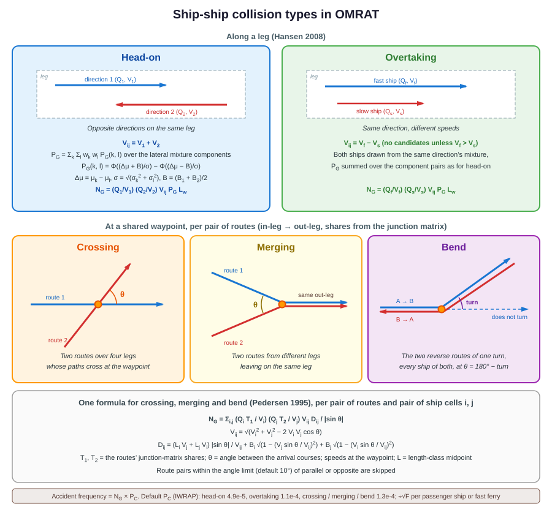

.. _collisions:

================================
Ship-Ship Collision Calculations
================================

This chapter describes OMRAT's calculations for ship-ship collision
risk.  Five encounter types are modelled -- head-on, overtaking,
crossing, merging and bend -- based on the equations in Pedersen
(1995) and Friis-Hansen (2008).

.. contents:: In this chapter
   :local:
   :depth: 2

Overview
========

Ship-ship collisions occur when two vessels occupy the same space at the
same time. The IWRAP methodology models this by calculating the
**geometric number of collision candidates** -- the expected number of
close encounters per year assuming no evasive action -- and then
multiplying by a **causation factor** to get the actual accident
frequency.

         crossing, merging and bend per pair of routes at a shared waypoint

The sections below derive each formula in the figure.  The figure is
drawn by ``help/figures_src/make_collision_types_figure.py``; re-run it
when a formula or a default causation factor changes.

The general formula is:

.. math::

   F_{\text{collision}} = N_G \times P_C

Where:

- :math:`N_G` = geometric collision candidates per year
- :math:`P_C` = causation probability (IALA default values)

.. container:: source-code-ref pipeline

   **Pipeline orchestrator:** ``compute/ship_collision_model.py:1070`` -- `run_ship_collision_model() <https://github.com/axelande/OMRAT/blob/main/compute/ship_collision_model.py#L1070>`__

Head-On Collisions
==================

Head-on collisions occur between vessels travelling in **opposite
directions** on the same leg. This is the classical encounter type for
narrow shipping lanes.

Geometry
--------

Two streams of traffic travel in opposite directions. The collision
probability depends on the lateral overlap of their position
distributions.

Equations (Hansen Eq. 4.2--4.4)
--------------------------------

The geometric number of collision candidates is:

.. math::

   N_G = \frac{Q_1}{V_1} \times \frac{Q_2}{V_2} \times V_{ij}
         \times P_G \times L_w \times \frac{1}{\text{sec/year}}

Where:

- :math:`Q_1, Q_2` = traffic volume in each direction (ships/year)
- :math:`V_1, V_2` = vessel speeds (m/s)
- :math:`V_{ij} = V_1 + V_2` = relative closing speed (m/s)
- :math:`L_w` = leg segment length (m)
- :math:`P_G` = geometric collision probability

The term :math:`Q/V` converts from traffic frequency (ships/year) to
traffic density (ships/m), accounting for the time ships spend on the
leg.

The geometric collision probability is:

.. math::

   P_G = \Phi\!\left(\frac{\mu_{ij} + B_{ij}}{\sigma_{ij}}\right)
       - \Phi\!\left(\frac{\mu_{ij} - B_{ij}}{\sigma_{ij}}\right)

Where:

- :math:`\mu_{ij} = \mu_1 + \mu_2` -- combined mean lateral distance
  (head-on: positions add because ships face opposite directions)
- :math:`\sigma_{ij} = \sqrt{\sigma_1^2 + \sigma_2^2}` -- combined
  standard deviation
- :math:`B_{ij} = (B_1 + B_2) / 2` -- average vessel breadth (collision
  width)
- :math:`\Phi` = standard normal CDF

The sum :math:`\mu_1 + \mu_2` is Hansen's convention, where each mean is
measured from its own sailing direction.  OMRAT stores both directions on
one lateral axis (negative = starboard of the drawn direction), so the
code takes the difference of the two stored means; the distance between
the lanes, and so :math:`P_G`, is the same.

With a mixture (up to three normal components and a uniform part per
direction) :math:`P_G` is evaluated **component by component** and
weighted: :math:`P_G = \sum_i \sum_j w_i w_j P_G(i, j)`, the normal x
uniform and uniform x uniform pairs in closed form
(``basic_equations.lateral_overlap_probability``, cached per mean
half-breadth), and :math:`N_G` then follows from
``basic_equations.head_on_candidates_from_overlap``.  Until 2026-11-09 each
direction's mixture was first collapsed into one normal (mixture mean,
total variance), which smears a two-lane leg into the middle: on one
two-lane leg of the Kattegat benchmark model head-on came out 3.9 times
too high, head-on -13.5 % over the whole model.  Overtaking is evaluated
the same way, both ships drawn from the same direction's mixture
(``basic_equations.overtaking_candidates_from_overlap``).  The
single-normal functions referenced below
(``get_head_on_collision_candidates`` /
``get_overtaking_collision_candidates``) are the textbook form of the
same equations; the model no longer calls them.

.. container:: source-code-ref

   ``compute/basic_equations.py:338`` -- `get_head_on_collision_candidates() <https://github.com/axelande/OMRAT/blob/main/compute/basic_equations.py#L338>`__

.. literalinclude:: ../../compute/basic_equations.py
   :language: python
   :pyobject: get_head_on_collision_candidates
   :caption: Head-on collision candidate calculation, one normal per direction (compute/basic_equations.py)

Default causation factor
-------------------------

.. math::

   P_C = 4.9 \times 10^{-5} \quad \text{(Fujii et al. 1974)}

Overtaking Collisions
=====================

Overtaking collisions occur between vessels travelling in the **same
direction** at different speeds. The faster vessel catches up to the
slower one.

Geometry
--------

Both vessels travel in the same direction. The collision probability
depends on the speed difference (overtaking is only possible if
:math:`V_{\text{fast}} > V_{\text{slow}}`) and the lateral overlap of
their distributions.

Equations (Hansen Eq. 4.5)
---------------------------

The formula is structurally identical to head-on, but with different
relative speed and lateral offset:

.. math::

   V_{ij} = V_{\text{fast}} - V_{\text{slow}}

.. math::

   \mu_{ij} = \mu_{\text{fast}} - \mu_{\text{slow}}

.. note::

   If :math:`V_{\text{fast}} \leq V_{\text{slow}}`, overtaking is
   impossible and the result is zero.

The geometric probability :math:`P_G`, combined standard deviation
:math:`\sigma_{ij}`, and breadth :math:`B_{ij}` are calculated
identically to the head-on case.

.. container:: source-code-ref

   ``compute/basic_equations.py:535`` -- `get_overtaking_collision_candidates() <https://github.com/axelande/OMRAT/blob/main/compute/basic_equations.py#L535>`__

Default causation factor
-------------------------

.. math::

   P_C = 1.1 \times 10^{-4} \quad \text{(Fujii et al. 1974)}

Crossing Collisions
===================

Crossing collisions occur at waypoints where two routes cross at an
angle :math:`\theta`. This is common at traffic separation scheme
junctions, port approaches, and areas where multiple routes converge.
OMRAT counts them only where the legs share a waypoint (see
:ref:`junctions`): two legs that cross without a common waypoint must be
split there, which the route validation offers.

Geometry
--------

Two traffic streams cross at angle :math:`\theta`, the angle between
their arrival courses at the waypoint. The collision zone is an area
around the waypoint whose size depends on vessel dimensions and the
crossing angle.

Equations (Pedersen 1995)
--------------------------

The two streams have linear densities :math:`Q_1/V_1` and
:math:`Q_2/V_2` (ships per metre of leg).  Candidates accumulate at the
rate at which one stream sweeps the other's collision cross-section:

.. math::

   N_G = \frac{Q_1}{V_1} \cdot \frac{Q_2}{V_2}
         \cdot V_{ij} \cdot \frac{D_{ij}}{|\sin\theta|}

Where:

- :math:`\theta` = crossing angle (radians)
- :math:`V_{ij}` = relative speed (metres/second)
- :math:`D_{ij}` = geometric collision diameter (metres)

The **relative speed** uses the law of cosines:

.. math::

   V_{ij} = \sqrt{V_1^2 + V_2^2 - 2 V_1 V_2 \cos\theta}

The **collision diameter** is the width of the Minkowski sum of the two
hulls projected onto the normal of the *relative* velocity -- the
cross-section ship 2 sweeps as seen from ship 1:

.. math::

   D_{ij} = \frac{(L_1 V_2 + L_2 V_1)\,|\sin\theta|}{V_{ij}}
          + B_1 \sqrt{1 - \left(\frac{V_2 \sin\theta}{V_{ij}}\right)^2}
          + B_2 \sqrt{1 - \left(\frac{V_1 \sin\theta}{V_{ij}}\right)^2}

Where :math:`L_1, L_2` are ship lengths and :math:`B_1, B_2` are ship
beams.  Note the pairing: :math:`B_1` carries :math:`V_2` inside the
root, and vice versa.  Modelling each hull as an :math:`L \times B`
rectangle, ship 1's projection onto that normal is
:math:`(L_1 V_2 |\sin\theta| + B_1 |V_1 - V_2\cos\theta|)/V_{ij}`, and
the identity
:math:`\sqrt{V_{ij}^2 - V_2^2 \sin^2\theta} = |V_1 - V_2\cos\theta|`
gives the square-root form above.

In OMRAT :math:`L` is the midpoint of the cell's length class (the column
of the traffic matrices) and :math:`B` the cell's mean beam, or
:math:`L / 6.5` when the beam is missing (0 or not given).  Until
2026-11-09 the length was taken from the matrix *row*, the ship type, so
with the default categories a pleasure craft was 162.5 m long and every
cargo ship 150 m in the collision diameter.  The speeds are the speeds at the waypoint (they
differ from the speed along the leg only in a speed restriction zone).

.. admonition:: Sanity check
   :class: tip

   Equal speeds, :math:`\theta = 90^\circ`: every term picks up
   :math:`1/\sqrt{2}` and
   :math:`D_{ij} = (L_1 + L_2 + B_1 + B_2)/\sqrt{2}` -- exactly the
   projected width of both rectangles onto the 45-degree normal.  This
   is checked directly in
   ``tests/test_ship_ship_collisions.py::test_crossing_diameter_equals_projected_hull_width``.

Because :math:`Q/V` appears twice and :math:`V_{ij}` once, crossing
candidates scale as :math:`1/V` -- faster traffic spends less time in
the conflict zone.  Head-on and overtaking obey the same law.

.. note::

   When :math:`\theta \to 0` or :math:`\theta \to \pi` (parallel or
   anti-parallel courses), :math:`\sin\theta \to 0` and the crossing
   formula is not applicable; such ships meet head-on or overtake on a
   leg instead.  OMRAT skips route pairs within the angle limit of
   parallel or opposite (see `Angle limit at waypoints`_).

.. warning:: Changed in v0.14.0

   Earlier versions omitted :math:`V_{ij}` from the numerator and used
   the unweighted collision diameter
   :math:`D_{ij} = (L_1+L_2)|\sin\theta| + (B_1+B_2)|\cos\theta|`.  Two
   consequences: crossing candidates scaled as :math:`1/V^2` instead of
   :math:`1/V` (head-on and overtaking were always correct), and the
   beam contribution vanished entirely at right-angle crossings, where
   :math:`\cos\theta = 0`.

   On the bundled example project the corrected formula raises crossing
   by about **5.6x** and merging by about **4.8x**.  Crossing, merging
   and bend numbers from runs before v0.14.0 are therefore **not**
   comparable with current ones; re-run any project you want to compare.

.. container:: source-code-ref

   ``compute/basic_equations.py:626`` -- `get_crossing_collision_candidates() <https://github.com/axelande/OMRAT/blob/main/compute/basic_equations.py#L626>`__

.. literalinclude:: ../../compute/basic_equations.py
   :language: python
   :pyobject: get_crossing_collision_candidates
   :caption: Crossing collision with law of cosines (compute/basic_equations.py)

Default causation factor
-------------------------

.. math::

   P_C = 1.3 \times 10^{-4} \quad \text{(Pedersen 1995)}

.. _merging-collisions:

Merging Collisions
==================

A **merging** encounter is two streams converging onto the same leg, for
example a feeder lane joining a main fairway.  It uses the crossing
geometry at the angle between the two arrival courses; the two streams
end up on one course, typically at a shallower angle and a lower closing
speed than a broadside crossing, so it is worth reporting separately.

OMRAT counts both per pair of **routes** through a waypoint (see
:ref:`junctions`): two routes that leave on the same leg merge, two routes
over four different legs whose paths cross around the waypoint cross.  The
angle is the one between their arrival courses.  Until 2026-11-09 the type
came from the acute angle between two legs (30 degrees or less = merging),
which also let consecutive legs of one route merge with themselves.  The
*equations are identical* to the crossing case above -- only the
causation factor differs, so a project can calibrate merging
independently:

.. math::

   P_C^{\mathrm{merging}} = 1.3 \times 10^{-4}
   \quad \text{(defaults to the crossing value)}

IWRAP publishes no separate merging causation factor, which is why the
default matches crossing.  Set it under **Settings -> Causation
Factors -> Merging causation factor**.

.. note:: Changed in v0.14.0

   Merging used to be classified internally but summed into the
   **crossing** total, while the Run Analysis row labelled "Merging
   collision" was fed the *bend* number.  Merging and bend are now
   separate accident types with their own rows, causation factors and
   consequence-matrix entries.  There is no automatic migration: a
   ``.omrat`` file written before v0.14.0 needs a ``pc['merging']``
   entry and a 9th row in each spill matrix.  Opening the Causation
   Factors dialog and the Consequence dialogs and saving writes both.

.. _crossing_traffic_distribution:

How OMRAT distributes traffic between legs at a junction
---------------------------------------------------------

A common question from new users:

   *"At a crossing or merging point, how does OMRAT decide which
   fraction of leg A's traffic continues to leg B vs leg C?"*

**With the junction's transition matrix** :math:`T[\mathrm{in}][\mathrm{out}]`
(see :ref:`junctions`).  Every waypoint where legs meet has one: counted
from AIS (matched transits per trip), edited by hand, or -- when neither
exists -- a geometric default that favours the straightest continuation
(a waypoint with only two legs sends everything on).  A **route** through
the waypoint is *in-leg -> out-leg*: the ships of the in-leg's direction
that arrives at the waypoint, times :math:`T[\mathrm{in}][\mathrm{out}]`.
Crossing, merging and bend are counted per pair of routes, for every pair
of ship cells :math:`i` (route 1) and :math:`j` (route 2):

.. math::

   N_G = \sum_{i,j} \frac{(Q_i T_1) \cdot (Q_j T_2) \cdot V_{ij} \cdot D_{ij}}
                         {V_i V_j |\sin\theta| \cdot \text{sec/year}}

where :math:`T_1`, :math:`T_2` are the two routes' matrix shares,
:math:`\theta` is the angle between their arrival courses and the speeds
are those at the waypoint.  Which route pairs count, and as which type, is
listed in :ref:`junctions`: two routes leaving on the same leg merge, two
routes over four legs whose paths cross around the waypoint cross, and the
two reverse routes of one turn are a bend (see `Bend Collisions`_).

The traffic of each leg still comes from that leg's own table.  AIS
counts the ships crossing each leg's passage line independently, so a
ship that sails leg A and then leg B is in both legs' counts; the matrix
only says how the ships *arriving* on a leg divide over the legs they
leave on.  It never moves ships from one leg to another (only
:ref:`suppress-leg` does that).

.. container:: source-code-ref

   ``compute/ship_collision_model.py`` -- ``_calc_crossing_collisions``
   builds the routes at every waypoint (``_junction_routes``), classifies
   each pair (``_route_pair_kind``) and skips pairs within the angle limit
   of parallel or opposite (see `Angle limit at waypoints`_).

Bend Collisions
===============

Bend collisions occur at waypoints where routes change direction.  A ship
on route :math:`A \to B` that does not change course at the waypoint
carries straight on, across the path of the ships coming the other way:
the reverse route :math:`B \to A`.

Origin of the rule
------------------

Friis-Hansen (2008) gives no bend equation of its own.  Section 4.1 counts
"two routes [that] intersect each other in a turn" among the waypoint
encounters computed with the crossing equation, and section 4.4 says that
at a bend "a ship can become a collision candidate if the course is not
changed at the intersection", with an omission probability
:math:`P_0 = 0.01`.  IWRAP Mk II computes the bend as the crossing encounter
of the two reverse routes with every ship of both, without :math:`P_0`
(found by comparing IWRAP's results per waypoint, see
:ref:`iwrap-differences`).  OMRAT does the same since November 2026.

Equations
---------

At a waypoint with legs :math:`A` and :math:`B`, route :math:`A \to B`
carries the ships arriving on :math:`A` times the junction matrix share
:math:`T_{AB}` (see :ref:`junctions`), and route :math:`B \to A` the ships
arriving on :math:`B` times :math:`T_{BA}`.  For every pair of ship cells
:math:`i` (on :math:`A \to B`) and :math:`j` (on :math:`B \to A`):

.. math::

   N_{\text{bend}} = \sum_{i,j} N_G^{\text{crossing}}\left(
       Q_i T_{AB},\; Q_j T_{BA},\; V_i, V_j, L_i, L_j, B_i, B_j,\; \alpha\right)

where :math:`\alpha` is the angle between the two arrival courses, i.e.
180 degrees minus the turn, and :math:`N_G^{\text{crossing}}` is the
crossing formula above.  Each pair of reverse routes is counted once: a
ship-to-ship pair is one encounter, whichever of the two fails to turn.
Speeds are the speeds at the waypoint.  A turn smaller than the angle
limit gives no bend: the arrival courses are then within that angle of
opposite (see `Angle limit at waypoints`_ below).

The bend is a waypoint encounter like crossing and merging: the collision
breakdown lists it per leg pair, the waypoint result layer per waypoint.
The per-leg tables give each of the two legs half of it.

.. warning:: Changed in November 2026

   Until then the bend was the 1 % of ships that fail to turn against the
   99 % of the *same* route that do turn, at the turn angle, computed per
   leg at its end point with both directions' traffic.  Those ships come
   along the same leg in the same direction and move apart after the
   waypoint, so the crossing formula had no real encounter to count, and
   the result depended on the direction in which the legs were drawn.
   Bend numbers from earlier runs are not comparable: the new bend is
   typically one to two orders of magnitude larger.

Bend is reported as its own row in the Accident probabilities table.  It
is *not* the same accident as a merging collision -- a bend is the two
directions of one turn meeting, a merge is two routes leaving on the same
leg.  See :ref:`merging-collisions`.

.. container:: source-code-ref

   ``compute/ship_collision_model.py`` -- ``_route_pair_kind`` (``'bend'``)
   and ``_junction_route_encounters``

Default causation factor
-------------------------

.. math::

   P_C = 1.3 \times 10^{-4} \quad \text{(Pedersen 1995)}

.. _angle-limit-at-waypoints:

Angle limit at waypoints
========================

Crossing, merging and bend all use the crossing formula, which divides by
:math:`|\sin\theta|`.  Two routes whose arrival courses are nearly parallel
(overtaking-like) or nearly opposite (head-on-like) would therefore get an
unbounded count.  OMRAT counts a pair of routes only when

.. math::

   \theta_{\min} \le \theta \le 180^\circ - \theta_{\min}

where :math:`\theta` is the angle between the arrival courses.  The courses
are the directions of the legs at the waypoint, measured in the model's map
projection (the transverse Mercator projection centred on the model that the
powered models also use), so a turn is the turn a chart shows.  Until
November 2026 they were taken straight from the longitude and latitude
differences, which treats a degree of longitude as long as a degree of
latitude: at 57 degrees north a 44-degree turn came out as 28 degrees and a
50-degree one as 80.  On the Kattegat benchmark model the correction lowered
bend by about 6 %, crossing by 2 % and merging by under 1 %.  The default
:math:`\theta_{\min} = 10^\circ` is the range of validity Friis-Hansen
(2008, section 4.1) gives for the crossing equations (10 to 170 degrees)
and the limit IWRAP uses.  For a bend :math:`\theta` is 180 degrees minus
the turn, so a turn smaller than :math:`\theta_{\min}` gives no bend.

The limit is set in **Settings > Causation factors** (*Smallest angle
between routes at a waypoint*, 1 to 45 degrees) and stored as
``pc.min_encounter_angle_deg``.  It does not affect head-on and overtaking
on a leg.  Until November 2026 the limit was fixed at 0.1 rad (5.7
degrees).  On the Kattegat benchmark model the change to 10 degrees lowered
the bend frequency by about 16 %, from gentle turns of 5.7 to 10 degrees;
crossing and merging changed only marginally.

.. container:: source-code-ref

   ``compute/encounter_angle.py``, ``geometries/model_projection.py``
   (``projected_bearing``) and
   ``compute/ship_collision_model.py`` -- ``_junction_route_encounters``

Passenger ship and fast ferry reduction
=======================================

Like IWRAP, OMRAT lowers the causation factor of passenger ships and fast
ferries (high speed craft), whose bridge manning and equipment make a
human error less likely.  With the reduction factor :math:`F` the
causation factor of an encounter is multiplied by :math:`1/\sqrt{F}` for
every passenger ship or fast ferry in it:

.. math::

   P_C^{(ij)} = P_C \, s_i \, s_j, \qquad
   s = \begin{cases}
         1/\sqrt{F} & \text{passenger ship or fast ferry} \\
         1 & \text{any other ship type}
       \end{cases}

With :math:`F = 20` a passenger ship meeting a cargo ship gets
:math:`P_C/\sqrt{20}` and two passenger ships :math:`P_C/20`.  It applies
to all five encounter types.  There is one factor for passenger ships and
one for fast ferries, both 20 by default (IWRAP's default; 1 means no
reduction), set in **Settings > Causation factors** and stored as
``pc.passenger_reduction`` / ``pc.fast_ferry_reduction``.  Which rows of
the traffic matrices count follows the ship type name (passenger, ro-pax,
cruise and ferry types; high speed craft and fast ferries).  The powered
models divide these ships' frequency by :math:`F` instead (see
:ref:`powered`).

.. container:: source-code-ref

   ``compute/passenger_reduction.py`` (``collision_scales``) and
   ``compute/ship_collision_model.py`` -- ``collision_type_scale``

Calculation Workflow
====================

The collision calculation proceeds as follows:

1. **Prepare the traffic**: the run's copy of the traffic is gap-filled
   (a cell with ships but no speed gets the traffic-weighted mean of the
   same ship type and length on the other legs, else of the same type,
   else of the same length, else 10 knots; see :ref:`traffic-gaps`),
   scaled, redirected for suppressed legs and capped in speed
   restriction zones (:ref:`speed-restriction-zones`) before any model
   reads it.

2. **Extract traffic data**: For each leg, extract all ship cells
   (ship type x length class) with their frequencies, speeds, beams and
   the lateral distribution of both directions.

3. **Pair ship cells**: For head-on, pair every cell in direction 1
   with every cell in direction 2; for overtaking, every faster cell
   with every slower one in the same direction.  At every waypoint where
   legs meet, pair the cells of every two routes that form a crossing,
   merging or bend (see :ref:`crossing_traffic_distribution`).

4. **Calculate per-pair N_G**: Apply the appropriate formula based on
   encounter type, using the specific vessel speeds, lengths, beams, and
   lateral distributions.  Head-on and overtaking use the speed along the
   leg, waypoint encounters the speed at the waypoint.

5. **Apply causation factor**: Multiply each pair by :math:`P_C` of its
   encounter type, reduced for passenger ships and fast ferries (see
   above), and sum over all pairs.

6. **Display results**: Results are shown in the UI as annual accident
   frequencies per collision type.

Summary of Equations
=====================

.. list-table::
   :widths: 20 30 20 30
   :header-rows: 1

   * - Type
     - Relative Speed
     - Lateral Offset
     - Key Parameter
   * - Head-on
     - :math:`V_1 + V_2`
     - :math:`\mu_1 + \mu_2`
     - Opposite directions
   * - Overtaking
     - :math:`V_f - V_s`
     - :math:`\mu_f - \mu_s`
     - Same direction, :math:`V_f > V_s`
   * - Crossing
     - :math:`\sqrt{V_1^2+V_2^2-2V_1V_2\cos\theta}`
     - :math:`D_{ij}`
     - Crossing angle :math:`\theta`
   * - Merging
     - (crossing formula)
     - (crossing formula)
     - Routes leaving on the same leg
   * - Bend
     - (crossing formula)
     - (crossing formula)
     - Reverse routes, :math:`180^\circ -` turn
