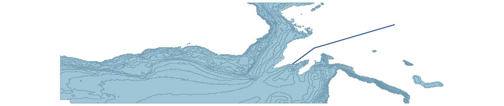

.. _concepts:

=========
Concepts
=========

This chapter is a glossary of the terms used throughout the rest of
the documentation and the plugin UI.  Each entry has a short
definition and pointers to where the concept matters (which tab,
which tab field, which function).

Read this once, then use it as a lookup when you hit an unfamiliar
word.

.. contents:: Glossary
   :local:
   :depth: 1

Route, segment, leg
====================

A **route** is a polyline on the map representing a shipping lane.
OMRAT splits a route into **segments** (also called **legs**) at
vertices you digitise.  Each segment is a single straight line between
two waypoints.

Every segment has its own:

* Geometry (two endpoints in lon/lat, hung on shared waypoints -- see
  below).
* Traffic matrix (per direction).
* Lateral distribution (per direction).
* Width -- the length of the tangent line, i.e. how wide a band the AIS
  query counts ships in (and the drawn corridor).  The risk models do
  not read it.

Two numbers identify a leg.  **Segment_Id** is the internal key: it is
assigned when the leg is drawn and never reused, even after legs are
removed.  The leg *name* ``LEG_<route>_<n>`` carries the route number
and the leg number within that route (the **Route** and **Next leg
no.** spin boxes on the Routes tab); a leg split later gets a letter
suffix such as ``LEG_1_2_b``.  Reports and result layers use the name.

**Where:** Routes tab.  **Why it matters:** every accident type is
computed per segment and summed.

Waypoint and junction
======================

Legs do not just touch: their ends hang on shared **waypoints**.
Moving a waypoint moves every leg on it; a click near an existing
waypoint while drawing snaps to it.  A waypoint where two or more leg
ends meet is a **junction**.  Each junction has a **transition
matrix** saying which share of the ships arriving on one leg leave on
each other leg (from the geometry, from AIS trips, or set by hand).
Crossing, merging and bend collisions are computed only at shared
waypoints, so legs that cross each other must be split there.

**Where:** canvas (Vertex Tool), **Settings -> Waypoint editor...**,
**Settings -> Junction transition matrix...**.  See :ref:`junctions`.

Tangent line (AIS passage line)
================================

A short line across each leg, as long as the leg's Width, by default at
its midpoint.  It is where **Update AIS** counts the passing ships, and
the lateral distributions are drawn on it as curves.  **Move tangent**
on the Routes tab slides it along the leg, for example away from a
junction where other routes' ships would be counted too.  The risk
models do not use its position.

**Where:** the *Tangent Line* map layer.  See
:ref:`moving-the-tangent-line`.

Direction
==========

Each segment has **two directions of travel** -- e.g. "North going"
and "South going" on a meridional leg, or "East going" / "West going"
on a parallel leg.  OMRAT auto-labels these from the segment's
compass bearing (four 90-degree sectors) when you digitise, and renames
them if a drag moves the leg into another sector.

**Direction 1 is always the traffic sailing in the drawn direction**
(start point -> end point), direction 2 the reverse -- in the traffic
tables, the lateral distribution panel, the AIS binning and the
powered model alike.  A negative lateral offset is to starboard of the
drawn direction.

Ship-ship head-on collisions arise between a segment's two
directions.  Overtaking happens within one direction.  Powered
calculations consider each direction independently (they define
different "bend turning points").

**Where:** Routes tab (``Dirs``), Traffic Data tab
(per-direction matrix).

Traffic cell
=============

One entry in the traffic matrix: the number of ships of a given
**type** (row) in a given **LOA bin** (column) per year.  Each cell
also stores a representative speed, draught, height, and beam.

A cell with zero frequency contributes zero to every accident type and
is skipped in the inner loops.  There are typically 21 types x 15 LOA
bins = 315 cells per direction, of which 10-30 are non-zero for a
real project.

**Where:** Traffic Data tab.

Wind rose
==========

An 8-value probability distribution over the compass directions
(N, NE, E, SE, S, SW, W, NW) telling OMRAT how often the wind (and
thus the drift direction) blows from each direction.  The dialog takes
percentages that must sum to 100 % (**Check sum** rescales them); the
project stores them as fractions summing to 1.

**Where:** Settings -> Drift settings.  **Why it matters:** the
drifting-model sum weights the 8-direction contributions by these
probabilities.

Drift corridor
===============

The swept polygon a drifting ship from a given segment in a given
direction could reach before being picked up by repair, anchoring, or
an obstacle.  Conceptually it is the union of:

* The segment's lateral band (the ship could start anywhere within
  the lateral distribution).
* That band translated by ``reach_distance`` in the drift direction,
  where ``reach_distance`` = drift speed * 99th-percentile repair
  time, capped at 10 x the longest leg.

**Where:** Drift Analysis tab for visualisation.

   Drift corridors for a single leg, one per compass direction.

Obstacle shadow
================

For each obstacle in a given drift direction, the **shadow** is the
extruded polygon behind the obstacle in that direction.  A drifting
ship that enters the shadow has already grounded / collided on the
obstacle that casts the shadow, so the shadow blocks farther obstacles
from contributing to that ship's risk.

Shadows are why OMRAT doesn't double-count: if a ship grounds on a
near reef, the same ship can't also ground on a deep reef beyond.
Each obstacle is first clipped to the corridor ahead of the leg, so
only the part a drifting ship can actually meet casts a shadow; water
behind the leg shields nothing.

**Where:** ``compute/drifting_model.py:_build_blocker_shadow``,
``geometries/drift/shadow.py:create_obstacle_shadow``.

Probability hole (:math:`h_X`)
================================

Given a leg, a drift direction, and an obstacle :math:`X`, the
**probability hole** is the probability that a drifting ship starting
uniformly along the leg (laterally distributed by the segment's PDF)
eventually reaches :math:`X`.  It is a pure geometric integral --
it does not yet include repair time.

OMRAT computes this with an **analytical cross-section CDF
integration**.  A Monte Carlo estimator
(``geometries/calculate_probability_holes.py``) is kept only as an
independent cross-check for tests and examples; a run cannot select
it.

**Where:** ``geometries/analytical_probability.py:compute_probability_analytical``.

Repair-time distribution and :math:`P_{NR}`
=============================================

The probability that the crew has *not* repaired the engine after
drifting time :math:`t` is

.. math::

   P_{NR}(t) = 1 - F_\mathrm{repair}(t)

where :math:`F_\mathrm{repair}` is the CDF of a lognormal distribution
(the default) or a user-defined expression in the time ``x`` (hours),
for example a Weibull or normal CDF.  OMRAT pattern-matches the
common shapes and uses :func:`scipy.special.ndtr` directly for a ~650x
speedup over the scipy frozen-distribution path.

**Where:** Settings -> Drift settings -> Repair time.  Implemented in
``compute/basic_equations.py:get_not_repaired``.

Anchoring
==========

A drifting ship in water shallow enough (``depth < anchor_d *
draught``) **may** successfully anchor.  This is modelled as a
conditional probability ``anchor_p``.  Anchoring events are summed
separately from grounding/allision -- they represent *saved* ships.
A leg that already lies inside anchorable water can anchor from the
start of the drift.

**Where:** Settings -> Drift settings (``anchor_p``, ``anchor_d``).
Output: the drifting report's ``totals['anchoring']``.

Causation factor
=================

The probability that a geometric accident candidate becomes an actual
accident.  IWRAP derives these from historical data; OMRAT ships the
standard values:

.. list-table::
   :header-rows: 1

   * - Accident type
     - Default :math:`P_C`
   * - Head-on
     - :math:`4.9 \times 10^{-5}`
   * - Overtaking
     - :math:`1.1 \times 10^{-4}`
   * - Crossing
     - :math:`1.3 \times 10^{-4}`
   * - Merging
     - :math:`1.3 \times 10^{-4}` (the crossing value; IWRAP publishes
       no separate figure)
   * - Bend
     - :math:`1.3 \times 10^{-4}`
   * - Powered grounding (Category I and II)
     - :math:`1.6 \times 10^{-4}`
   * - Powered allision (Category I and II)
     - :math:`1.9 \times 10^{-4}`
   * - Drifting
     - :math:`1.0` (no avoidance -- the ship is powerless)

Category I and Category II have separate fields with the same defaults.

**Where:** Settings -> Causation Factors.

Category I vs Category II (powered)
=====================================

IWRAP splits powered risk into two categories, and OMRAT computes
both (``run_powered_grounding_model`` and
``run_powered_allision_model``) and adds them into one powered total:

* **Category I** -- the obstacle already lies inside the leg's lateral
  distribution, so ships sail straight into it without any turn being
  required.  The probability is the share of ships whose track meets
  the obstacle along the leg; no distance or speed enters.  By default
  hits in the first 10 % of the leg after the waypoint the ships come
  from are ignored (:ref:`cat1-start-zone`).
* **Category II** -- the ship fails to turn at the waypoint where the
  leg ends (in its direction of travel) and continues straight into
  whatever is ahead.

**Why the distinction matters:** Category II uses an exponential
decay :math:`\exp(-d/(a_i V))` that models the chance the crew notices
the missed turn (one position check every :math:`a_i` seconds, the
*mean time between checks* on the Routes tab) before reaching the
obstacle; :math:`a_i = 0` switches Category II off for that leg and
direction.  The two categories have their own causation factors, and
the report splits the powered totals between them.  See
:ref:`powered`.

Lateral distribution
=====================

Per segment, per direction, a PDF describing where ships sit across
the leg.  In OMRAT this is a mixture of up to three Gaussian
components and one uniform component.  Practical projects mostly use
a single Gaussian; **Update AIS** fits one per direction (mean and
sigma of the ships' crossing points on the tangent line).  The curves
are drawn on the tangent line on the map.

**Where:** the distribution panel underneath the route table on
the Routes tab.  **Why:** drifting corridor width, the powered rays
(both categories are cast over the whole mixture), ship-ship collision
overlap.

Standard nautical compass convention
======================================

OMRAT uses **nautical bearings**: 0 deg = North, 90 deg = East, 180
deg = South, 270 deg = West, measured **clockwise** from north.  The
wind rose, segment bearings, and drift directions all use this
convention.

Internal math uses the standard **math** convention (0 deg = East,
counter-clockwise).  The conversion is
:math:`\theta_\mathrm{math} = (90^\circ - \theta_\mathrm{compass}) \bmod 360^\circ`,
implemented once in
``drifting/engine.py:compass_to_math_deg``.

The ``data`` dict
==================

Everything that flows from the UI into the calculation is packed into
a single Python dict named ``data``.  :ref:`reference-data-format`
documents every key.  The same dict is serialised to ``.omrat`` JSON
files.

Run model vs Run analysis
==========================

Two buttons on two different tabs, doing different things:

* **Run model** (Run Analysis tab) -- the risk calculation.
  Returns numbers.  This is what
  :class:`~compute.calculation_task.CalculationTask` orchestrates
  (:ref:`code-flow`).
* **Run analysis** (Drift Analysis tab) -- visual drift-corridor
  generation only.  Does not return risk numbers.

Don't mix them up -- running the drift analysis doesn't produce
the numbers in the Accident probabilities table.
