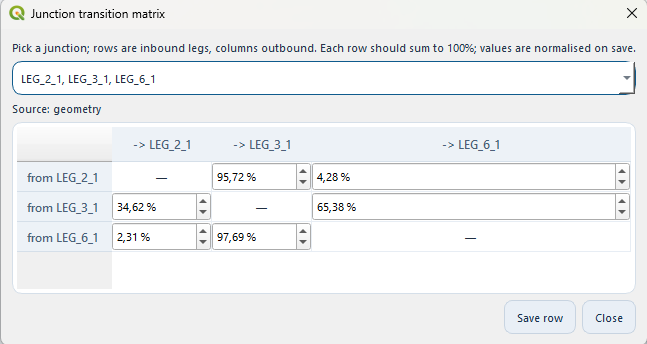

.. _junctions:

==========================================
Junctions and the transition matrix
==========================================

A **junction** is any point where two or more legs share an endpoint.
Today's projects often have several -- a Y where two routes converge,
an X where two through-routes cross, a chain of straight legs sharing
intermediate waypoints.  How traffic *splits* at these junctions matters
for collision risk: a 70%/30% split between two onward legs implies a
very different collision pattern than a 50/50 one, and not every leg
that *touches* a junction necessarily *exchanges* traffic with every
other.

OMRAT models this with a per-junction **transition matrix**

.. math::

   T[L_{\text{in}}][L_{\text{out}}] = \text{share of traffic continuing from } L_{\text{in}} \text{ to } L_{\text{out}}

where each row sums to 1.0.  Rows are populated from one of three
sources, in order of preference:

#. **AIS-derived** -- when a database connection is configured, OMRAT
   counts matched transits through the junction (see
   :ref:`junction-ais-counts` below) and normalises them per row.  This
   is the most accurate source.
#. **Geometry-derived** -- when AIS is unavailable, a fallback
   heuristic scores out-legs by their deflection angle from the
   inbound bearing (``exp(-deflection / 30 deg)``) and normalises.
   Straight continuations get the highest share, hairpins the lowest.
#. **User-edited** -- entered or tweaked via
   **Settings > Junction transition matrix...**, marked
   ``source="user"``, and preserved across subsequent
   *Update all distributions* runs.

.. _junction-ais-counts:

How the AIS counts are made
===========================

Every AIS segment that crosses a leg's passage line (the tangent line,
the same line the traffic update samples) is one *crossing*.  Its COG
sorts it into the leg's two directions with the same rule and maximum
deviation as the traffic binning, which tells whether the ship was
heading **towards** the junction (inbound) or **away** from it
(outbound).

Crossings are then grouped into trips by ``(mmsi, route_id)``, where the
segments table's ``route_id`` identifies one port-to-port trip.  Within
a trip, sorted by time, an inbound crossing on leg *i* directly followed
by an outbound crossing on leg *j* is one transit *i -> j*:

* every trip counts, so a ferry on 300 trips a year adds 300 transits;
* a trip that passes the junction twice counts twice;
* a U-turn (in and back out on the same leg) is not a transit.

Crossings that cannot be paired -- a trip that starts or ends between
the passage line and the junction, or whose other crossing was not
observed -- add nothing.  Each row is normalised over its matched
transits, so they do not change the shares.  After every junction pass
the QGIS log (``OMRAT`` tab) reports, for each junction with three or
more legs, how many inbound crossings were matched and how many
crossings carried a ``route_id``.

Segments without a ``route_id`` are paired per MMSI instead, and then
the two crossings must be at most 2 h apart.  A row with no matched
transit keeps its geometric default.

How a transition matrix changes the calculation
================================================

Two ship-collision sub-models become matrix-aware:

Bend collisions
---------------

Today, bend collision frequency on a leg is computed from a single
``bend_angle`` field plus the leg's total traffic.  When a junction
exists at the leg's end and has a populated matrix, the model instead
iterates over each ``(this_leg -> other_leg)`` matrix row, computing
the deflection angle between inbound and outbound bearings and
weighting traffic by the matrix share.  Pure-continuation pairs
(no deflection) drop out, and split-flow junctions naturally produce
multiple bend contributions.

If a leg has no junction at its end, or the junction has no matrix,
the legacy single-bend path is used (no behaviour change).

Crossing / merging collisions
------------------------------

For each leg pair sharing a junction, the contribution to crossing /
merging frequency is multiplied by a junction-aware **conflict factor**:

.. math::

   f = 1 - T[L_1][L_2] \cdot T[L_2][L_1]

Reasoning: when 100% of leg 1 continues onto leg 2 *and* 100% of leg 2
continues onto leg 1, the only encounter at the junction is a
head-on/overtaking exchange that the per-leg models already capture --
the crossing/merging adjustment is 0.  Any divergence (some traffic
going elsewhere) re-introduces a junction-level conflict, hence the
multiplicative complement.  Defaults to 1.0 when no matrix is set.

Validating routes before computing
====================================

Pressing **Update all distributions** runs a route-validation pass
*before* it touches AIS or the junction matrices.  Two checks fire:

* **Close waypoints** -- distinct leg endpoints within 5% of the
  shortest incident leg's length.  The dialog zooms the canvas to
  the candidate and offers to snap to point 1, point 2, or the
  midpoint.  The snap rewrites every leg endpoint matching either
  source coordinate to the chosen target.
* **Crossing legs (X-intersections)** -- two legs that geometrically
  cross at an interior point (not at a shared endpoint).  The dialog
  asks whether to split each leg in two at the crossing point,
  producing four sub-legs that share a real junction node.  Sub-legs
  inherit the parent leg's traffic block.

After the validation pass, the junction registry is rebuilt against
the (possibly mutated) segment list, AIS update runs as before, and
junction matrices are refreshed -- AIS-derived where data are
available, geometry-derived where not, and user-edited rows are left
alone.

The **Waypoint editor** (:ref:`waypoint-editor`) changes which legs
meet at a junction.  A detached leg end is kept further away than the
close-waypoint threshold, so this pass does not offer to join it again.
A hand-edited (``user``) matrix survives both edits: a leg that leaves
has its row and column dropped and the rows renormalised; a leg that
joins gets its geometric row and 0 % in the existing rows
(``geometries.junctions.carry_user_matrices``).  An ``ais`` matrix
falls back to geometry because its leg set changed and must be counted
again.

Editing a matrix manually
==========================

Open **Settings > Junction transition matrix...** to inspect or edit
the per-junction transition matrices.  The editor also opens by itself
after **Update all distributions** when at least one junction has three
or more legs (merging, diverging or crossing traffic).  It then starts on
the first such junction, because those are the matrices worth checking
after a fresh AIS count.  If the editor is already open, it re-reads the
rebuilt registry.

         combo, source label, and percentage spinbox grid.

   The Junction transition matrix dialog.  The combo at the top picks
   one junction (labelled with the ``LEG_{route}_{leg}`` names of
   every leg meeting there); the **Source** label shows whether the
   matrix came from AIS, geometry heuristics, or a user edit.

The picker combo lists every junction in the project; each entry is
just the comma-separated leg names that meet at that point, so the
grid headers below it use the matching names.  The grid has rows for
inbound legs and columns for outbound legs; the diagonal is fixed
(a leg cannot transition to itself), and each cell is a percentage
spinbox.

Click **Save row** to commit your edits for the currently displayed
junction.  Values are normalised to sum to 1.0 on save (so you don't
have to type exact percentages), and the junction's ``source`` is
flipped to ``"user"`` so future *Update all distributions* runs leave
it alone.

JSON layout
===========

The ``junctions`` block of a saved ``.omrat`` file is keyed by
junction id (a stable string derived from the coordinate, e.g.
``"j_15.000000_55.000000"``):

.. code-block:: json

    {
      "junctions": {
        "j_15.000000_55.000000": {
          "point": [15.0, 55.0],
          "legs":  {"1": "end", "2": "start", "3": "start"},
          "transitions": {
            "1": {"2": 0.7, "3": 0.3},
            "2": {"1": 1.0},
            "3": {"1": 1.0}
          },
          "source": "user"
        }
      }
    }

Suppressed legs
===============

A suppressed leg (:ref:`suppress-leg`) keeps its place in the live
registry, so restoring it needs no rebuild and user or AIS matrices
survive.  Only the calculation's copy is changed
(:func:`compute.traffic_redirect.drop_legs_from_junctions`):

* the leg's row and column are removed and the remaining rows are
  renormalised;
* a row whose whole share went to the suppressed leg falls back to the
  geometric default of the remaining legs;
* a junction left with fewer than two legs disappears.

Behind the scenes
=================

* Pure-geometry route validation:
  ``geometries/route_validation.py``
  (close-waypoint detection, X-intersection detection, snap, split).
* Junction registry + matrix derivation:
  ``geometries/junctions.py``.
* Plugin handler (live registry + load/save):
  ``omrat_utils/handle_junctions.py``.
* Validation-pass UI driver:
  ``omrat_utils/route_validation_ui.py``.
* Matrix editor dialog:
  ``omrat_utils/junction_matrix_dialog.py``.
* Waypoint editor: ``geometries/waypoints.py`` (``detach_leg_end``,
  ``attach_leg_end``, ``detach_limits``, ``attach_candidates``),
  ``geometries/junctions.py:carry_user_matrices`` and the dialog
  ``omrat_utils/waypoint_editor_dialog.py``.
* AIS-derived counts:
  ``compute/junction_transitions.py``
  (pure-Python trip pairing and normaliser) plus
  ``omrat_utils/handle_ais.py:fetch_passages_for_leg`` /
  ``compute_junction_transitions`` (database query and COG direction).
