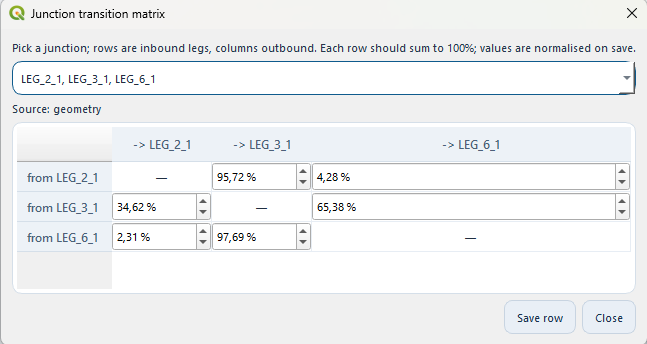

.. _junctions:

==========================================
Junctions and the transition matrix
==========================================

A **junction** is any point where two or more legs share an endpoint.
Today's projects often have several -- a Y where two routes converge,
an X where two through-routes cross, a chain of straight legs sharing
intermediate waypoints.  How traffic *splits* at these junctions matters
for collision risk: a 70%/30% split between two onward legs implies a
very different collision pattern than a 50/50 one, and not every leg
that *touches* a junction necessarily *exchanges* traffic with every
other.

OMRAT models this with a per-junction **transition matrix**

.. math::

   T[L_{\text{in}}][L_{\text{out}}] = \text{share of traffic continuing from } L_{\text{in}} \text{ to } L_{\text{out}}

where each row sums to 1.0.  Rows are populated from one of three
sources (a user-edited matrix always wins, then AIS, then geometry):

#. **AIS-derived** -- when a database connection is configured, OMRAT
   counts matched transits through the junction (see
   :ref:`junction-ais-counts` below) and normalises them per row.  This
   is the most accurate source.
#. **Geometry-derived** -- when AIS is unavailable, a fallback
   heuristic scores out-legs by their deflection angle from the
   inbound bearing (``exp(-deflection / 30 deg)``) and normalises.
   Straight continuations get the highest share, hairpins the lowest;
   a junction with only two legs sends 100 % on to the other leg.
   The bearings are measured in the model's map projection, like the
   angles in the collision model.
#. **User-edited** -- entered or tweaked via
   **Settings > Junction transition matrix...**, marked
   ``source="user"``, and preserved across subsequent
   *Update all distributions* runs.

Legs whose traffic was copied from one another (:ref:`copy-traffic`)
are treated as one route: where they meet, the AIS and geometric
matrices give them a 100 % continuation row instead of the count or the
heuristic.  User-edited rows still win.  Releasing the copy (unticking
**AIS lock**) removes that row again.

.. _junction-ais-counts:

How the AIS counts are made
===========================

Every AIS segment that crosses a leg's passage line (the tangent line,
the same line the traffic update samples) is one *crossing*.  Its COG
sorts it into the leg's two directions with the same rule and maximum
deviation as the traffic binning, which tells whether the ship was
heading **towards** the junction (inbound) or **away** from it
(outbound).

Crossings are then grouped into trips by ``(mmsi, route_id)``, where the
segments table's ``route_id`` identifies one port-to-port trip.  Within
a trip, sorted by time, an inbound crossing on leg *i* directly followed
by an outbound crossing on leg *j* is one transit *i -> j*:

* every trip counts, so a ferry on 300 trips a year adds 300 transits;
* a trip that passes the junction twice counts twice;
* a U-turn (in and back out on the same leg) is not a transit.

Crossings that cannot be paired -- a trip that starts or ends between
the passage line and the junction, or whose other crossing was not
observed -- add nothing.  Each row is normalised over its matched
transits, so they do not change the shares.  After every junction pass
the QGIS log (``OMRAT`` tab) reports, for each junction with three or
more legs, how many inbound crossings were matched and how many
crossings carried a ``route_id``.

Segments without a ``route_id`` are paired per MMSI instead, and then
the two crossings must be at most 2 h apart.  A row with no matched
transit keeps its geometric default.

**Update all distributions** always re-counts the junctions.  The
per-leg **Update AIS** button skips the junction pass when every
junction already holds an AIS (or user) matrix for the current legs.  An
AIS matrix survives file load and a rebuild of the registry as long as
the same legs meet at the junction; a width, tangent or vertex edit that
moves a leg's passage line resets the junctions at that leg to geometry,
so the next update counts them again.

How a transition matrix changes the calculation
================================================

The matrix decides how much traffic each route through the junction
carries, which is what the crossing, merging and bend collisions count.

Bend collisions
---------------

A bend is the pair of reverse routes through one turn, *A -> B* and
*B -> A*: a ship that does not change course meets the ships coming the
other way on the next leg.  Each route carries its in-leg's arriving
traffic times its matrix share, so a junction where most traffic goes
straight on has small bends.  The formula is the crossing formula at 180
degrees minus the turn; see :ref:`collisions`.

Crossing / merging collisions
------------------------------

Crossing and merging are counted per pair of **routes** through the
junction.  A route is *in-leg -> out-leg*: the traffic of the in-leg's
direction that arrives at the junction, at its speed there, times the
matrix share :math:`T[\mathrm{in}][\mathrm{out}]` (a leg never routes to
itself).  A junction without a stored matrix uses the geometric default.
Each pair of routes counts once:

.. list-table::
   :header-rows: 1
   :widths: 40 60

   * - The two routes
     - Encounter
   * - start on the same leg
     - none at the junction -- they sail in one lane (overtaking on the
       leg already counts them)
   * - leave on the same leg
     - **merging** (merging causation factor)
   * - use four different legs and their paths cross around the junction
     - **crossing** (crossing causation factor)
   * - are the two reverse routes of one turn (*A -> B* and *B -> A*)
     - **bend** (bend causation factor), see above
   * - anything else (one leaves on the leg the other arrives on)
     - none -- that is head-on on that leg, already counted there

The angle in Pedersen's formula is the angle between the two arrival
courses, measured in the model's map projection (see
:ref:`angle-limit-at-waypoints`); courses within the angle limit (**Settings > Causation factors**,
default 10 degrees) of parallel or opposite give no encounter, because the
formula divides by :math:`|\sin\theta|`.

The speeds are those at the junction (they differ from the speed along
the leg only in a speed restriction zone), and the causation factor is
reduced for passenger ships and fast ferries as on a leg.

So at a plain two-leg bend nothing crosses or merges (only the bend
counts), at a three-leg junction routes can merge and form bends but not
cross, and at an X with all traffic going straight through the four
crossing route pairs are counted once each.

.. note:: Changed 2026-11-09

   Before, every pair of legs at a junction was taken with all four
   direction combinations, weighted only by a conflict factor
   :math:`1 - T[L_1][L_2] \cdot T[L_2][L_1]` and classified by the acute
   angle between the legs (30 degrees or less = merging).  One X crossing
   was counted in four leg pairs, flows that both leave the junction were
   counted, and consecutive legs of one route "merged" with themselves.
   On the Kattegat benchmark model crossing fell from 0.61 to 0.068 and
   merging from 0.34 to 0.072 per year (together with the ship-length fix
   in :ref:`collisions`).

Validating routes before computing
====================================

Pressing **Update all distributions** runs a route-validation pass
*before* it touches AIS or the junction matrices.  Two checks fire:

* **Close waypoints** -- distinct leg endpoints within 5% of the
  shortest incident leg's length.  The dialog zooms the canvas to
  the candidate and offers to snap to point 1, point 2, or the
  midpoint.  The snap rewrites every leg endpoint matching either
  source coordinate to the chosen target.
* **Crossing legs (X-intersections)** -- two legs that geometrically
  cross at an interior point (not at a shared endpoint).  The dialog
  asks whether to split each leg in two at the crossing point,
  producing four sub-legs that share a real junction node.  Sub-legs
  inherit the parent leg's traffic block.

  Crossings are also caught where they are made: dragging a leg end on
  the map, or **Connect** in the Waypoint editor, so that a leg crosses
  others asks at once whether to split them, and **Run model** warns
  before a ship-ship collision run while unsplit crossings remain
  (**Split and run** / **Run anyway** / **Cancel**; pairs with a
  suppressed leg are ignored).  This matters for the result: crossing
  collisions are only computed where legs share a waypoint, so an
  unsplit crossing counts as zero.

After the validation pass, the junction registry is rebuilt against
the (possibly mutated) segment list, AIS update runs as before, and
junction matrices are refreshed -- AIS-derived where data are
available, geometry-derived where not, and user-edited rows are left
alone.

The **Waypoint editor** (:ref:`waypoint-editor`) changes which legs
meet at a junction.  A detached leg end is kept further away than the
close-waypoint threshold, so this pass does not offer to join it again.
A hand-edited (``user``) matrix survives both edits: a leg that leaves
has its row and column dropped and the rows renormalised; a leg that
joins gets its geometric row and 0 % in the existing rows
(``geometries.junctions.carry_user_matrices``).  An ``ais`` matrix
falls back to geometry because its leg set changed and must be counted
again.

Editing a matrix manually
==========================

Open **Settings > Junction transition matrix...** to inspect or edit
the per-junction transition matrices.  The editor also opens by itself
after **Update all distributions** when at least one junction has three
or more legs (merging, diverging or crossing traffic).  It then starts on
the first such junction, because those are the matrices worth checking
after a fresh AIS count.  If the editor is already open, it re-reads the
rebuilt registry.

         combo, source label, and percentage spinbox grid.

   The Junction transition matrix dialog.  The combo at the top picks
   one junction (labelled with the ``LEG_{route}_{leg}`` names of
   every leg meeting there); the **Source** label shows whether the
   matrix came from AIS, geometry heuristics, or a user edit.

The picker combo lists every junction in the project; each entry is
just the comma-separated leg names that meet at that point, so the
grid headers below it use the matching names.  The grid has rows for
inbound legs and columns for outbound legs; the diagonal is fixed
(a leg cannot transition to itself), and each cell is a percentage
spinbox.

Click **Save row** to commit your edits for the currently displayed
junction.  Values are normalised to sum to 1.0 on save (so you don't
have to type exact percentages), and the junction's ``source`` is
flipped to ``"user"`` so future *Update all distributions* runs leave
it alone.

JSON layout
===========

The ``junctions`` block of a saved ``.omrat`` file is keyed by
junction id (a stable string derived from the coordinate, e.g.
``"j_15.000000_55.000000"``):

.. code-block:: json

    {
      "junctions": {
        "j_15.000000_55.000000": {
          "point": [15.0, 55.0],
          "legs":  {"1": "end", "2": "start", "3": "start"},
          "transitions": {
            "1": {"2": 0.7, "3": 0.3},
            "2": {"1": 1.0},
            "3": {"1": 1.0}
          },
          "source": "user"
        }
      }
    }

Suppressed legs
===============

A suppressed leg (:ref:`suppress-leg`) keeps its place in the live
registry, so restoring it needs no rebuild and user or AIS matrices
survive.  Only the calculation's copy is changed
(:func:`compute.traffic_redirect.drop_legs_from_junctions`):

* the leg's row and column are removed and the remaining rows are
  renormalised;
* a row whose whole share went to the suppressed leg falls back to the
  geometric default of the remaining legs;
* a junction left with fewer than two legs disappears.

Behind the scenes
=================

* Pure-geometry route validation:
  ``geometries/route_validation.py``
  (close-waypoint detection, X-intersection detection, snap, split).
* Junction registry + matrix derivation:
  ``geometries/junctions.py``.
* Plugin handler (live registry + load/save):
  ``omrat_utils/handle_junctions.py``.
* Validation-pass UI driver:
  ``omrat_utils/route_validation_ui.py``.
* Matrix editor dialog:
  ``omrat_utils/junction_matrix_dialog.py``.
* Waypoint editor: ``geometries/waypoints.py`` (``detach_leg_end``,
  ``attach_leg_end``, ``detach_limits``, ``attach_candidates``),
  ``geometries/junctions.py:carry_user_matrices`` and the dialog
  ``omrat_utils/waypoint_editor_dialog.py``.
* AIS-derived counts:
  ``compute/junction_transitions.py``
  (pure-Python trip pairing and normaliser) plus
  ``omrat_utils/handle_ais.py:fetch_passages_for_leg`` /
  ``compute_junction_transitions`` (database query and COG direction).
* Use in the calculation: ``compute/ship_collision_model.py``
  (``_calc_crossing_collisions``: routes and route pairs per junction),
  ``compute/encounter_angle.py`` (angle limit) and
  ``geometries/model_projection.py`` (bearings).
