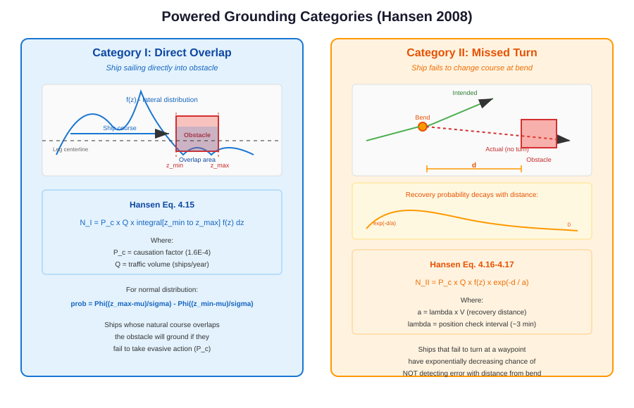
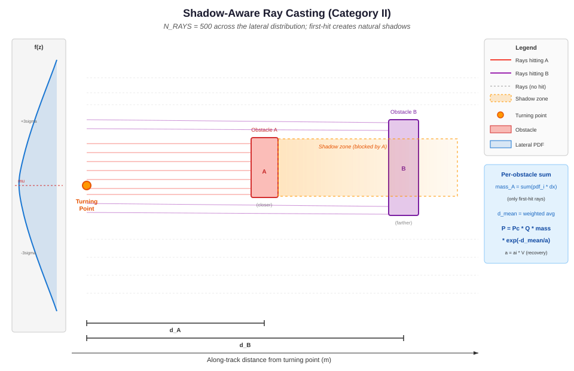
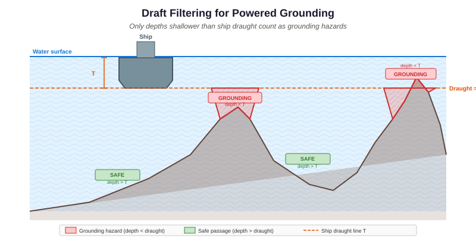

.. _powered:

===================================
Powered Grounding and Allision
===================================

This chapter describes OMRAT's calculations for powered grounding and
allision -- accidents involving ships that are under power but fail to
navigate correctly. Two categories are modelled based on Hansen (2008).

.. contents:: In this chapter
   :local:
   :depth: 2

Overview
========

Powered accidents occur when a vessel has operational engines but the
crew fails to take appropriate action. This can happen because of:

- Navigation errors
- Equipment malfunction
- Human factors (fatigue, distraction)
- Environmental conditions (poor visibility)

Unlike drifting accidents, powered accidents depend on the **lateral
traffic distribution** relative to obstacles and the **probability of
course correction** after an error.

Current implementation notes:

- Powered grounding uses **effective depth bins** (by depth contour)
   instead of recomputing geometry for every individual draught value.
- Progress is reported per obstacle-bin step, so long runs show
   meaningful status updates in the task manager.

.. container:: source-code-ref pipeline

   **Grounding pipeline:** ``compute/powered_model.py:417`` -- `run_powered_grounding_model() <https://github.com/axelande/OMRAT/blob/main/compute/powered_model.py#L417>`__ |
   **Allision pipeline:** ``compute/powered_model.py:458`` -- `run_powered_allision_model() <https://github.com/axelande/OMRAT/blob/main/compute/powered_model.py#L458>`__ |
   **Exponential decay:** ``compute/basic_equations.py:96`` -- `powered_na() <https://github.com/axelande/OMRAT/blob/main/compute/basic_equations.py#L96>`__

Category I: Direct Overlap
==========================

Category I covers ships whose natural course (based on their lateral
position in the traffic distribution) takes them directly into an
obstacle. These ships are sailing on a heading that overlaps with the
obstacle, and will ground/collide unless they take evasive action.

Equation (Hansen Eq. 4.15)
---------------------------

.. math::

   N_I = P_C \times Q \times \int_{z_{\min}}^{z_{\max}} f(z) \, dz

Where:

- :math:`P_C` = causation factor (:math:`1.6 \times 10^{-4}` for
  grounding)
- :math:`Q` = traffic volume (ships/year)
- :math:`f(z)` = lateral traffic distribution (PDF)
- :math:`z_{\min}, z_{\max}` = lateral extent of the obstacle
- The integral represents the fraction of traffic whose course overlaps
  the obstacle

For a **normal distribution**, the integral evaluates to:

.. math::

   \int_{z_{\min}}^{z_{\max}} f(z) \, dz =
   \Phi\!\left(\frac{z_{\max} - \mu}{\sigma}\right) -
   \Phi\!\left(\frac{z_{\min} - \mu}{\sigma}\right)

Where :math:`\Phi` is the standard normal CDF and :math:`\mu, \sigma`
are the mean and standard deviation of the lateral position distribution.

.. container:: source-code-ref

   ``compute/basic_equations.py:754`` -- `get_powered_grounding_cat1() <https://github.com/axelande/OMRAT/blob/main/compute/basic_equations.py#L754>`__

.. literalinclude:: ../../compute/basic_equations.py
   :language: python
   :pyobject: get_powered_grounding_cat1
   :caption: Category I -- direct overlap (compute/basic_equations.py)

Physical Interpretation
-----------------------

Category I accidents are "ships sailing into the obstacle". Even though
the ship has power, the crew may not be paying attention, may not see
the obstacle (e.g., submerged reef), or may misjudge the ship's
position. The causation factor :math:`P_C = 1.6 \times 10^{-4}` means
that roughly 1 in 6,000 geometric encounter candidates results in an
actual accident.

Implementation: in-lane ray casting
-----------------------------------

OMRAT evaluates the integral numerically with the same ray caster as
Category II (see :ref:`shadow-ray-casting` below), so shadowing and
arbitrary polygon shapes come for free:

1. For each leg and direction, cast ``N_RAYS = 1000`` rays *parallel to
   the leg* from the waypoint the ships come from, each carrying the
   mass :math:`m_i = f(z_i)\,\Delta z` of its lateral offset.
2. Clip every ray at the leg length.  An obstacle past the far
   waypoint is Category II territory for this leg; an obstacle whose
   near face lies inside the leg is hit before the turn and counts
   here.  The two categories therefore never score the same water
   twice.
3. Keep the first obstacle each ray hits.  A shoal lying behind
   another shoal along the leg only receives the rays the nearer one
   let through.
4. Per obstacle, ``mass`` is the sum of intercepted ray masses and

   .. math::

      N_I = P_{C,I} \times Q \times \text{mass}

   with **no distance term** -- the ship is already on a collision
   course, and neither its speed nor the position-check interval
   enters.  For grounding the draught filter (depth :math:`\le` ship
   draught) and for allision the clearance check (ship height
   :math:`\ge` structure height) apply exactly as for Category II.

.. _cat1-start-zone:

The start zone
~~~~~~~~~~~~~~

Right after the origin waypoint the parallel-ray picture is wrong: the
ships are still arriving from the previous leg, and their lateral
position is not yet described by this leg's fitted distribution.  An
obstacle lying next to a junction would otherwise collect the far tail
of the distribution of a leg whose ships never sail there.  In the ESCOW
case study a wind farm 5 km from a junction received 88 % of its powered
allision from the East-going flow of the leg *leaving* that junction:
the park began 2.4σ to starboard of the fitted mean and the 0.8 % tail
beyond it, times 10,000 ships a year and the causation factor, gave
1.5e-2 allisions a year, all within the first 8.5 km of a 134 km leg.

**Settings > Causation factors > Category I start zone** (default **on,
10 %**) drops every Cat I ray whose first edge crossing lies within the
given share of the leg, measured from the waypoint the ships come from.
Three consequences follow from the rule being applied per ray:

* An obstacle straddling the line keeps the rays that cross an edge
  beyond it; those rays are credited to the edge where they leave the
  start zone.
* The opposite direction is unaffected: its rays start at the far
  waypoint, so the same obstacle is met at 90-100 % of the leg and
  still counts (in the example the West-going ships are centred on the
  other side of the leg and never reach the park in either case).
* Category II is untouched.  A ship that misses the turn at the
  junction and continues straight along the *previous* leg is still
  scored by that leg's Category II.

Switching the setting off reproduces the plain IWRAP-style Category I.
The results Markdown states the setting under each powered section, and
the Compare tab lists it among the settings differences when two runs
disagree.

.. container:: source-code-ref

   ``geometries/get_powered_overlap.py`` -- `_compute_cat1_in_lane() <https://github.com/axelande/OMRAT/blob/main/geometries/get_powered_overlap.py>`__ |
   ``compute/powered_model.py`` -- `_iter_hit_probs() <https://github.com/axelande/OMRAT/blob/main/compute/powered_model.py>`__

.. tip::

   A wind farm placed *alongside* a straight leg, well inside its
   lateral spread, is a pure Category-I case: no bend is involved, so
   the Category-II model sees nothing.  Check the ``Category I`` line
   in the results Markdown when comparing with IWRAP.

Category II: Missed Turn at Bend
================================

Category II covers ships that fail to change course at a
waypoint/bend. The ship continues on its original heading instead of
turning, and may collide with an obstacle that lies ahead on the
original course.

.. note::

   ``run_powered_grounding_model`` and ``run_powered_allision_model``
   compute **both** categories and report their sum as the powered
   total; the split is kept in the report under ``totals['cat1']`` /
   ``totals['cat2']`` and in the Markdown results file.  Each category
   has its own causation factor: ``pc['grounding']`` /
   ``pc['allision']`` are the Category-II factors (IWRAP
   ``p_*_no_turn_causation``) and ``pc['grounding_cat1']`` /
   ``pc['allision_cat1']`` the Category-I ones (IWRAP
   ``p_*_causation``) -- see :ref:`iwrap-causation-mapping`.  Before
   v0.15.0 OMRAT computed Category II only.

The probability decreases **exponentially** with distance from the bend,
because the crew has more opportunities to detect and correct the course
error the further they travel.

Equation (Hansen Eq. 4.16--4.17)
---------------------------------

.. math::

   N_{II} = P_C \times Q \times f(z) \times \exp\!\left(
     -\frac{d}{a}
   \right)

Where:

- :math:`d` = distance from the bend to the obstacle (metres)
- :math:`a = \lambda \times V` = recovery distance (metres)
- :math:`\lambda` = position check interval (minutes, converted to
  seconds)
- :math:`V` = ship speed (m/s)
- :math:`f(z)` = probability density at the lateral position where the
  original heading leads to the obstacle

.. container:: source-code-ref

   ``compute/basic_equations.py:792`` -- `get_powered_grounding_cat2() <https://github.com/axelande/OMRAT/blob/main/compute/basic_equations.py#L792>`__

.. literalinclude:: ../../compute/basic_equations.py
   :language: python
   :pyobject: get_powered_grounding_cat2
   :caption: Category II -- exponential decay (compute/basic_equations.py)

Recovery Distance
-----------------

The **recovery distance** :math:`a` represents the average distance a
ship travels between position checks:

.. math::

   a = \lambda \times V = (\lambda_{\text{min}} \times 60) \times V

Where :math:`\lambda_{\text{min}}` is the position check interval in
minutes. A typical value is :math:`\lambda = 3` minutes, meaning the
navigator checks the ship's position approximately every 3 minutes.

For a ship travelling at 10 knots (~5.1 m/s):

.. math::

   a = 3 \times 60 \times 5.1 \approx 920 \text{ m}

.. container:: source-code-ref

   ``compute/basic_equations.py:730`` -- `get_recovery_distance() <https://github.com/axelande/OMRAT/blob/main/compute/basic_equations.py#L730>`__

Exponential Decay
-----------------

The term :math:`\exp(-d/a)` represents the probability that the ship
has **not** detected its course error before reaching the obstacle.

- At :math:`d = 0` (obstacle at bend): :math:`\exp(0) = 1` (no time to
  detect)
- At :math:`d = a` (one check interval away): :math:`\exp(-1) \approx 0.37`
- At :math:`d = 3a` (three check intervals): :math:`\exp(-3) \approx 0.05`
- At :math:`d = 5a` (five check intervals): :math:`\exp(-5) \approx 0.007`

This means obstacles close to bends are much more dangerous than
obstacles far from bends, because the crew has less time to detect and
correct the error.

Physical Interpretation
-----------------------

Category II models the "missed turn" scenario. A ship approaching a
waypoint should change course, but some fraction of ships (weighted by
:math:`P_C`) continue straight. The exponential decay represents the
crew's progressive awareness: at each position check interval, they have
a chance to notice they are off course and correct.

.. _shadow-ray-casting:

Shadow-Aware Ray Casting
========================

The Category II equations above describe the probability for a
*single ray* from the turning point to a single obstacle. In practice,
the lateral traffic distribution means ships may be at any lateral
offset when they miss the turn. OMRAT evaluates this by casting
**1000 rays** across the lateral distribution, from :math:`\mu - 6\sigma` to :math:`\mu + 6\sigma`.

The Algorithm
--------------

For each leg and direction (turning point + extension direction):

1. **Sample the lateral distribution**: Generate ``N_RAYS = 1000``
   equally spaced offsets from :math:`\mu - 6\sigma` to
   :math:`\mu + 6\sigma` (``compute/ray_sampling.py``), where :math:`\mu` and :math:`\sigma` are
   the lateral distribution parameters.

2. **Compute PDF weights**: For each offset :math:`z_i`, evaluate the
   normal PDF and multiply by the spacing:

   .. math::

      m_i = f(z_i) \times \Delta z

   This gives the probability *mass* carried by each ray.

3. **Cast each ray**: From the turning point offset laterally by
   :math:`z_i`, cast a ray in the extension direction (the heading the
   ship would continue on after missing the turn). The ray extends up
   to 50 km.

4. **First-hit logic**: For each ray, find the *closest* obstacle it
   intersects. This is the key step -- a ray can only hit one obstacle.
   If obstacle A is closer than obstacle B on a given ray, only A
   receives that ray's mass.

5. **Accumulate per obstacle**: For each obstacle, collect:

   - **mass** = sum of :math:`m_i` for all rays that hit it (first)
   - **weighted distance** = :math:`\sum m_i \times d_i`
   - **mean distance** = weighted distance / mass
   - **probability integral** = :math:`\sum m_i \times \exp(-d_i / a)`

6. **Compute final probability**: For each obstacle:

   .. math::

      P_{\text{obs}} = P_C \times Q \times \text{mass}
        \times \exp\!\left(-\frac{d_{\text{mean}}}{a}\right)

   Where :math:`a = \lambda \times V` is the recovery distance.

Performance Optimization (Depth-Bin Caching)
--------------------------------------------

Powered grounding now groups ships by an **effective depth bin**:

1. Extract unique depth contour values from ``depths``.
2. Map each ship draught to the deepest contour that is still shallower
   than or equal to that draught.
3. Run expensive shadow/ray computations **once per bin**, then reuse
   results for all ship classes mapped to that bin.

This avoids repeated ray-casting with identical obstacle sets and
significantly reduces runtime on projects with many draught entries.

.. container:: source-code-ref

   ``compute/powered_model.py:85`` -- depth-bin grouping and caching in `run_powered_grounding_model() <https://github.com/axelande/OMRAT/blob/main/compute/powered_model.py#L85>`__ |
   ``compute/powered_model.py:114`` -- per-bin progress updates |
   ``compute/powered_model.py:178`` -- ship draught -> cached bin mapping

.. container:: source-code-ref

   ``geometries/get_powered_overlap.py:415`` -- `_compute_cat2_with_shadows() <https://github.com/axelande/OMRAT/blob/main/geometries/get_powered_overlap.py#L415>`__

Shadow Effect
--------------

The first-hit logic naturally creates **shadows**. When a closer
obstacle intercepts a set of rays, those rays never reach any obstacle
behind it. The farther obstacle only receives rays that pass *around*
the closer one.

::

   Lateral offset (z)
   |
   |  miss  miss  miss                 miss  miss
   |   .     .     .                     .     .
   |    .    .    .          SHADOW        .    .
   |     .   .   .    +---------+------+   .   .
   |   hit-A hit-A    | Obs A   | (blocked)|   .
   |     .   .   .    +---------+------+   .   .
   |    .    .    .          SHADOW        .    .
   |   .     .     .                     .     .
   |  hit-B hit-B hit-B               hit-B hit-B
   +---------------------------------------------------> distance

This approach differs from drifting risk, where shadows are created by
*geometric subtraction* of corridor polygons. In the powered model,
shadows emerge from the ray-casting itself -- no explicit shadow
geometry is needed.

**Mass conservation**: The sum of masses across all obstacles plus the
"miss" mass (rays that hit nothing) equals 1.0 (within numerical
precision). Each ray's mass is assigned to exactly one obstacle or
none, so there is no double-counting.

The **View** dialog (see :ref:`powered-visualization` below) makes
this visible: the lateral distribution strip of each Cat I / Cat II
panel is filled with the colour of the obstacle each ray hits first,
and the rays stop at that obstacle.

Draft Filtering for Grounding
==============================

For powered **grounding**, not all depth areas are hazardous. A depth
area is only a grounding risk if the water is shallower than the
ship's draught:

.. math::

   \text{Hazard if:} \quad \text{depth} \leq T_{\text{ship}}

Where :math:`T_{\text{ship}}` is the ship's draught in metres.

Since different ship types have different draughts, the set of
obstacles varies per ship type. A large tanker with :math:`T = 15` m
faces more grounding hazards than a small ferry with :math:`T = 4` m.

To avoid running the expensive ray-casting computation once per ship
type, OMRAT groups ships by **unique draught values**:

1. Collect all unique draughts from the traffic data
2. For each unique draught, filter depth areas to those
   :math:`\leq T` and build the obstacle list
3. Run the shadow-aware ray casting once per draught bracket
4. When summing per-ship-type contributions, look up the
   pre-computed results for the closest matching draught bracket

For powered **allision** (hitting structures above water), draft
filtering does not apply -- all objects are obstacles regardless of
ship draught.

.. container:: source-code-ref

   ``compute/powered_model.py:215`` -- `_collect_draught_set() <https://github.com/axelande/OMRAT/blob/main/compute/powered_model.py#L215>`__

Computation Pipeline
=====================

The full powered risk computation is orchestrated by
``powered_model.py``, which provides two methods:
``run_powered_grounding_model()`` and ``run_powered_allision_model()``.

Grounding Pipeline
-------------------

::

   1. Build equirectangular projector from first segment
   2. Collect all unique draughts from traffic data
   3. For each unique draught:
      a. Filter depth areas to those <= draught
      b. Build projected obstacle list
      c. Run _run_all_computations():
         For each (leg, direction):
           - Determine turning point and extension direction
           - Cat II: cast 1000 rays from the turning point onwards
           - Cat I:  cast 1000 rays along the leg, clipped at its length
           - First-hit logic assigns each ray to nearest obstacle
           - Accumulate mass and mean distance per obstacle and category
   4. For each (leg, direction, LOA class, ship type):
      a. Get ship frequency Q, speed V, draught T, check interval ai
      b. Look up shadow results for closest draught bracket
      c. For each obstacle hit:
         Cat II: total += Pc_II * Q * mass * exp(-d_mean / (ai * V))
         Cat I:  total += Pc_I  * Q * mass

Allision Pipeline
------------------

The allision pipeline is simpler because no draft filtering is needed:

::

   1. Build equirectangular projector from first segment
   2. Build projected obstacle list (all objects, ignore depths)
   3. Run _run_all_computations() once for all obstacles (Cat I + II)
   4. For each (leg, direction, LOA class, ship type):
      a. Get ship frequency Q, speed V, check interval ai, ship height
      b. Skip obstacles the ship clears (ship height < structure height)
      c. For each obstacle hit:
         Cat II: total += Pc_II * Q * mass * exp(-d_mean / (ai * V))
         Cat I:  total += Pc_I  * Q * mass

Per-Ship-Type Parameters
-------------------------

The final summation loops over every ship type in the traffic data.
Key parameters that vary per ship type:

.. list-table::
   :widths: 25 35 40
   :header-rows: 1

   * - Parameter
     - Symbol
     - Effect
   * - Traffic frequency
     - :math:`Q` (ships/year)
     - Linear scaling of risk
   * - Ship speed
     - :math:`V` (m/s)
     - Affects recovery distance :math:`a = \lambda \times V`
   * - Ship draught
     - :math:`T` (m)
     - Determines which depths are hazards (grounding only)
   * - Position check interval
     - :math:`\lambda` (seconds)
     - Affects recovery distance; set per segment direction

Faster ships have a *longer* recovery distance, which means the
exponential decay is gentler -- obstacles far from the bend are
relatively more dangerous for fast ships. Conversely, slow ships have
a short recovery distance, so the exponential drops off quickly.

.. container:: source-code-ref pipeline

   ``compute/powered_model.py:417`` -- `run_powered_grounding_model() <https://github.com/axelande/OMRAT/blob/main/compute/powered_model.py#L417>`__ |
   ``compute/powered_model.py:458`` -- `run_powered_allision_model() <https://github.com/axelande/OMRAT/blob/main/compute/powered_model.py#L458>`__

.. _powered-visualization:

Visualization
==============

The **View** button of the *Powered allision* and *Powered grounding*
rows opens an interactive dialog for the run selected in **Previous
runs**, implemented by ``PoweredOverlapVisualizer``.  It shows the
shadow-aware ray-casting results in four panels, with a table on the
right and a matplotlib toolbar (pan / zoom / save) above the figure.

Leg table
---------

One row per analysed (leg, direction), largest contributor first.  The
table is the only way to choose what the panels show -- both directions
of a leg run along the same line of the map, so a click there could
not tell them apart.

- **Leg** and **Direction** -- the names of the route table
  (``LEG_6_1_b`` / ``East going``), the same as in the Markdown report
  and the result layers.  The tooltip adds the segment id.
- **Frequency (/yr)** -- the leg-direction's annual powered accident
  frequency (Cat I + Cat II, all obstacles).
- **% of total** -- its share of the run's powered allision /
  grounding total, as in the collision breakdown.

The figures come from the ``<run>.powered.json`` file written next to
the run's GeoPackage.  For runs saved before that file existed,
allision frequencies are recomputed from the run's input snapshot;
grounding shows the per-ship hit probability instead and ``--`` for
the share (re-run the model to get them).

Overview (top)
--------------

Every leg in grey and the obstacles.  The selected leg is drawn in its
direction colour with its :math:`\pm 3\sigma` band and an arrow in the
travel direction, labelled with its name; the title gives its annual
frequency and share of the total.  Two dashed boxes show the areas the
Cat I and Cat II panels below are looking at.  The legend and a short
how-to sit to the right of the map.

To look closer at any panel, press the magnifier in the toolbar and
drag a box; the arrows button pans and the house button resets.
Picking another row starts afresh.

Cat I panel (bottom left)
-------------------------

The leg in its own frame: the ships enter at :math:`x = 0`, the
turning point is the dashed line at :math:`x = L`, and the panel is
the map *rotated* so the ships travel left to right
(:math:`+y` = left of the heading).  It is drawn to **true scale** and
zoomed to the obstacles that are hit (largest contributors first; a
hit far from them is left to the toolbar zoom, and the dashed box on
the overview shows where the window is).  The rays run from
:math:`x = 0` to the first in-lane obstacle; the grey band at the
start is the Cat I start zone, the light area past :math:`x = L`
belongs to Cat II.

The strip at the left edge is the lateral distribution of the ships on
the same lateral scale, filled with the colour of the obstacle each ray
hits first.  When the window does not reach :math:`x = 0`, the strip
says how far to the left the rays start.  The legend names the hit
obstacles with their mass; the title gives
:math:`P_I = \text{mass}`.

Cat II panels (bottom right)
----------------------------

- **Geometry** (upper): the same kind of true-scale, zoomed frame
  starting at the turning point -- ships that miss the turn continue
  straight on, each ray stopping at the first obstacle; the legend
  gives each obstacle's mass and mean distance :math:`d`.
- **Probability** (lower, same x-axis): the survival curve
  :math:`\exp(-d / (a_i V))` on a log scale.  For each obstacle the
  open marker is the survival at :math:`d_{mean}`, the filled marker
  :math:`P_{II} = \text{mass} \times \text{survival}`; the label spells
  out the product.  The title shows the recovery distance
  :math:`a_i V`.

The shadow effect is visible in both categories: a ray that hits a
nearer obstacle never reaches the ones behind it, so a wide nearby
obstacle leaves little mass for those further away.

.. container:: source-code-ref

   ``geometries/get_powered_overlap.py:869`` -- `PoweredOverlapVisualizer <https://github.com/axelande/OMRAT/blob/main/geometries/get_powered_overlap.py#L869>`__

Combined Powered Risk
=====================

The total powered accident frequency for an obstacle is the sum of
Category I and Category II contributions from all legs and ship types:

.. math::

   F_{\text{powered}} = \sum_{\text{legs}} \sum_{\text{dirs}}
     \sum_{\text{types}} (N_{I} + N_{II,k})

Where :math:`N_{II,k}` includes the shadow-aware mass and exponential
decay computed by the ray-casting algorithm. The summation runs over:

- All route legs (segments)
- Both travel directions per leg
- All ship types (LOA class x type category)

The ``powered_model.py`` module orchestrates this computation. The
shadow-aware geometry (mass and mean distance per obstacle) is computed
once per unique draught bracket, then reused across all ship types
with that draught.

Comparison with Drifting Risk
==============================

.. list-table::
   :widths: 25 35 40
   :header-rows: 1

   * - Aspect
     - Drifting Risk
     - Powered Risk
   * - Ship status
     - Engine failure (blackout)
     - Under power
   * - Causation factor
     - 1.0 (no avoidance possible)
     - :math:`1.6 \times 10^{-4}` (avoidance likely)
   * - Direction
     - Wind/current driven (8 dirs)
     - Along ship's heading
   * - Key parameter
     - Repair time, wind rose
     - Lateral distribution, bend distance
   * - Spatial model
     - Drift corridors
     - Distribution overlap / exp decay
   * - Typical magnitude
     - Higher per-event
     - Lower per-event, but more frequent

In practice, powered risks often dominate for obstacles near route
centrelines, while drifting risks dominate for obstacles that are off to
the side of routes.

Causation Factor Summary
=========================

.. list-table::
   :widths: 40 30 30
   :header-rows: 1

   * - Accident Type
     - Default :math:`P_C`
     - Source
   * - Powered grounding, Cat II (``grounding``)
     - :math:`1.6 \times 10^{-4}`
     - IALA / Fujii
   * - Powered grounding, Cat I (``grounding_cat1``)
     - :math:`1.6 \times 10^{-4}`
     - IALA (same figure as Cat II)
   * - Powered allision, Cat II (``allision``)
     - :math:`1.9 \times 10^{-4}`
     - Fujii et al. 1974
   * - Powered allision, Cat I (``allision_cat1``)
     - :math:`1.9 \times 10^{-4}`
     - IALA (same figure as Cat II)
   * - Drifting (all types)
     - :math:`1.0`
     - N/A (powerless)

.. _ray-sampling:

Ray span and ray count
----------------------

Both categories sample the lateral distribution with ``N_RAYS = 1000``
rays between :math:`\mu - 6\sigma` and :math:`\mu + 6\sigma` of the
direction's first normal component (``compute/ray_sampling.py``).  Until
2026-10-02 the span was :math:`4\sigma` with 500 rays; the mass of a
normal beyond :math:`4\sigma` is 6.3e-5 per side, which on a 10,000
ships-a-year leg is an accident frequency of the order of 1e-4 per year
once an obstacle sits out there, more than a whole Category II total on
the ESCOW project.  Doubling the ray count keeps the spacing finer than
before (0.012 :math:`\sigma` against 0.016).  Powered grounding time
grows with the ray count: on the ESCOW project from 117 s to about
200 s.

The two figures are constants, not project settings, and every results
Markdown states them under each powered section ("Ray sampling").  On
the canvas the **Tangent Line** layer marks where the rays start and stop
with a short dashed tick per direction at :math:`\mu \pm 6\sigma`, in
the colour of that direction's distribution curve; when the span reaches
past the drawn lane the tick stands at its true position with a thin
dashed extension from the end of the tangent line, so a span wider than
the lane is visible at a glance.  Rays beyond the lane sample a region
the AIS fit never saw, so treat what they find as the tail of an
assumption, not as an observation.
